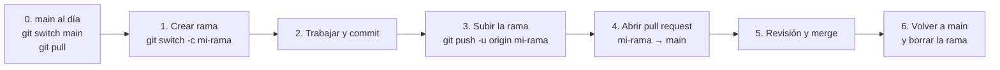

# Guía de contribución

Cómo trabajar en el repositorio: ramas, commits, pull requests y reglas de código.

## Flujo de trabajo

Una tarea, una rama. Los cambios llegan a `main` mediante pull request.
El flujo está dibujado en [`flujo-ramas-pull-request.excalidraw`](flujo-ramas-pull-request.excalidraw).

<!-- TODO: `.github/copilot-instructions.md` dice que el equipo trabaja directamente sobre `main`, y el diagrama dice que nadie escribe en `main`. Esta guía sigue el diagrama, que es lo que refleja el historial de pull requests. Confirmar y unificar. -->



### Pasos

1. Actualiza `main`:

   ```bash
   git switch main
   git pull
   ```

2. Crea tu rama desde `main`:

   ```bash
   git switch -c nombre-de-la-rama
   ```

3. Trabaja con commits pequeños:

   ```bash
   git add .
   git commit -m "feat: descripción breve"
   ```

4. Sube la rama:

   ```bash
   git push -u origin nombre-de-la-rama
   ```

5. Abre una pull request hacia `main` en GitHub.
6. Espera la revisión y la aprobación. <!-- TODO: indicar quién revisa; el diagrama nombra a una persona concreta. -->
7. Fusiona la pull request y borra la rama en GitHub.
8. Limpia en local:

   ```bash
   git switch main
   git pull
   git branch -d nombre-de-la-rama
   ```

### Si `main` avanza mientras trabajas

Hazlo antes de abrir la pull request, para resolver los conflictos en tu rama:

```bash
git switch main
git pull
git switch nombre-de-la-rama
git merge main
```

## Mensajes de commit

El historial usa prefijos al estilo Conventional Commits, como `feat:` y `docs:`.
Escribe un mensaje breve que explique qué cambia.

## Integración continua

Cada pull request hacia `main` ejecuta el workflow [`build-and-test.yml`](.github/workflows/build-and-test.yml).
Restaura, compila en Release y lanza las pruebas. Comprueba que pasa antes de pedir revisión.

Para reproducirlo en local:

```bash
dotnet restore G3AspNet.sln
dotnet build G3AspNet.sln --configuration Release --no-restore
dotnet test G3AspNet.sln --configuration Release --no-build
```

## Reglas de código

- Los espacios de nombres siguen las carpetas, con la raíz `G3AspNet`.
- Se usan tipos de referencia anulables, `using` implícitos, espacios de nombres de archivo y sangría de cuatro espacios. Está configurado en [`.editorconfig`](.editorconfig).
- Los controladores se mantienen simples: usa view models, comprueba `ModelState.IsValid` en los formularios y delega la lógica de cuentas en `UserService`.
- Usa `RoleNames` en lugar de escribir los nombres de rol como texto.
- Obtén el identificador del usuario con `ClaimsPrincipalExtensions.GetRequiredUserId()`.
- Protege las acciones con `[Authorize]` y, cuando proceda, con roles.
- Si cambias una entidad, avisa a quien la mantiene. No modifiques entidades, controladores ni vistas de otra persona sin comentarlo.

## Cambios en el modelo de datos

El proyecto no usa migraciones. No las generes.

1. Modifica la entidad en [`Models/`](Models).
2. Configura la relación y su `OnDelete` en [`ApplicationDbContext`](Data/ApplicationDbContext.cs).
3. Añade filas de ejemplo en [`DbInitializer`](Data/DbInitializer.cs).
4. Actualiza el [modelo de datos](docs/diagrama-er.md).

La base de datos se recrea en cada arranque.

## Documentación

Si cambias el comportamiento visible, actualiza el documento que corresponda:

| Cambio | Documento |
|---|---|
| Permisos o reglas de negocio | [Guía funcional](docs/guia-funcional.md) |
| Entidades, campos o enums | [Modelo de datos](docs/diagrama-er.md) |
| Cuentas o datos de ejemplo | [Demostración](docs/demo.md) |
| Paquetes | [Dependencias](docs/DEPENDENCIAS.md) |
| Configuración, ejecución o estructura | [README](README.md) |

## Wiki

El [wiki del proyecto](https://github.com/certidevs/g3_aspnet/wiki) se genera a partir de estos documentos.
El workflow [`sync-wiki.yml`](.github/workflows/sync-wiki.yml) lo actualiza en cada cambio de `README.md`, `CONTRIBUTING.md` o `docs/` que llegue a `main`.

- No edites el wiki a mano: los cambios se sobrescriben. Edita el archivo del repositorio.
- Para publicar un documento nuevo, añádelo al diccionario `PAGES` de [`scripts/build-wiki.py`](scripts/build-wiki.py).
- Un documento eliminado del repositorio no se borra del wiki. Bórralo allí a mano.
