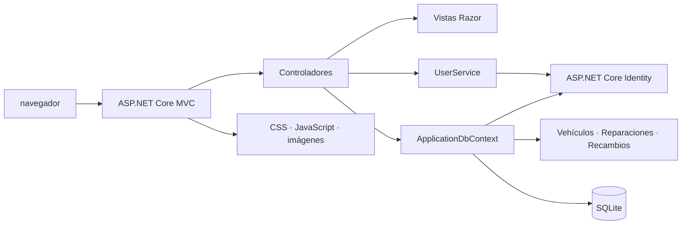

# G3 ASP.NET Core · Gestión de taller mecánico

[](https://github.com/certidevs/g3_aspnet/actions/workflows/build-and-test.yml)
[](https://dotnet.microsoft.com/apps/aspnet)
[](G3AspNet.csproj)
[](https://www.sqlite.org/)
[](tests/G3AspNet.Tests/G3AspNet.Tests.csproj)

Aplicación web ASP.NET Core MVC para gestionar usuarios, vehículos, reparaciones y recambios de un taller. Proyecto académico del Grupo 3, construido con Razor, Entity Framework Core, SQLite y ASP.NET Core Identity.

> **Estado del proyecto:** aplicación en desarrollo. Al iniciar, se elimina y recrea la base de datos; con la siembra activada (valor predeterminado) también se cargan datos de demostración. No debe desplegarse con datos que se necesite conservar.

## Contenido

- [Características](#características)
- [Tecnologías y arquitectura](#tecnologías-y-arquitectura)
- [Estructura](#estructura)
- [Requisitos](#requisitos)
- [Instalación y ejecución](#instalación-y-ejecución)
- [Configuración](#configuración)
- [Datos de demostración](#datos-de-demostración)
- [Pruebas](#pruebas)
- [CI y contenedor](#ci-y-contenedor)
- [Contributors](#contributors)
- [Limitaciones conocidas](#limitaciones-conocidas)

## Características

- **Cuentas y perfiles:** registro (solo rol `User`), inicio y cierre de sesión con Identity; edición del perfil, cambio de contraseña y avatar. Los roles del taller se asignan desde administración o los datos demo.
- **Administración de usuarios:** búsqueda, creación, edición, activación y eliminación de cuentas desde el área administrativa.
- **Vehículos:** ficha con matrícula, VIN, marca, modelo, año, combustible, kilometraje y propietario. Los clientes solo consultan sus propios vehículos; el personal del taller puede gestionarlos.
- **Reparaciones:** asociación de vehículo y mecánico, tipo y estado de reparación, fechas, kilometraje, horas y tarifa de mano de obra; el total suma mano de obra y piezas.
- **Recambios:** catálogo con referencia, precio y niveles de stock.
- **Piezas por reparación:** registro de cantidad y precio unitario histórico; añadir piezas descuenta stock y eliminarlas o borrar la reparación lo repone.
- **Interfaz:** vistas Razor, Bootstrap y recursos locales de Font Awesome.

Los controladores aplican distintas restricciones de acceso según el módulo. La aplicación protege globalmente las peticiones POST con antifalsificación.

## Tecnologías y arquitectura

- **.NET 10 / C#** con ASP.NET Core MVC y Razor.
- **ASP.NET Core Identity** para cuentas, contraseñas, roles y cookies.
- **Entity Framework Core 10** con proveedor **SQLite**.
- **Bootstrap**, JavaScript y CSS para la interfaz; Font Awesome se sirve desde `wwwroot`.
- **xUnit** para pruebas automatizadas.
- **Docker** y **GitHub Actions** para empaquetado y CI.

La aplicación registra controladores MVC, autenticación/autorización y servicios. Los controladores usan `ApplicationDbContext` para el dominio y `UserService` para operaciones reutilizables de cuentas; las vistas Razor presentan los modelos y view models. `DbInitializer` crea el esquema y los datos de ejemplo al arrancar.



### Modelo de dominio

- `ApplicationUser` puede tener vehículos como cliente y reparaciones asignadas como mecánico.
- `Vehicle` conserva su historial de `Repair`.
- `RepairPart` enlaza `Repair` y `SparePart`, y guarda cantidad y precio unitario.
- Las relaciones de historial usan borrado restringido; las líneas `RepairPart` se eliminan junto con su reparación.

## Estructura

```text
Controllers/              Acciones MVC para cuentas, usuarios y dominio
Data/                     ApplicationDbContext y DbInitializer
Models/                    Identity y entidades de taller
Services/                  UserService y almacenamiento de avatares
Utilities/                 Extensiones para claims del usuario
ViewModels/                Modelos específicos de formularios y páginas
Views/                     Plantillas Razor agrupadas por controlador
wwwroot/                   CSS, JavaScript, imágenes y librerías locales
tests/G3AspNet.Tests/      Proyecto de pruebas xUnit
docs/                      Guías de IDE y dependencias
.github/workflows/         Flujo de CI de GitHub Actions
Dockerfile                 Imagen multi-stage para contenedor
```

## Requisitos

- SDK de **.NET 10**. `global.json` fija `10.0.100` y permite versiones posteriores de la misma línea mediante `rollForward: latestFeature`.
- Git para clonar el repositorio.
- Visual Studio Code y C# Dev Kit, opcionales para desarrollar con el entorno recomendado: [instalación en Windows, macOS y Linux](docs/IDE-SETUP.md).
- Docker, opcional, para ejecutar la imagen.

## Instalación y ejecución

Desde una terminal:

```bash
git clone https://github.com/certidevs/g3_aspnet.git
cd g3_aspnet
dotnet --version
dotnet restore G3AspNet.sln
dotnet run --project G3AspNet.csproj --launch-profile http
```

Abre <http://localhost:5107>. El perfil `http` establece el entorno `Development`; también existe un perfil `https` en `Properties/launchSettings.json`.

Para compilar y ejecutar las pruebas:

```bash
dotnet build G3AspNet.sln
dotnet test G3AspNet.sln
```

## Configuración

Los valores predeterminados están en `appsettings.json`. ASP.NET Core permite sustituirlos mediante variables de entorno usando `__` como separador jerárquico.

| Clave | Valor predeterminado | Uso |
|---|---|---|
| `ConnectionStrings:DefaultConnection` | `Data Source=App_Data/g3.db` | Archivo SQLite relativo a la raíz del proyecto. |
| `SeedData:Enabled` | `true` | Carga roles, usuarios y datos de ejemplo después de crear el esquema. |
| `FileUploads:Images:MaxFileSizeBytes` | `5242880` | Tamaño máximo de imagen: 5 MiB. |
| `FileUploads:Images:AllowedExtensions` | `.jpg`, `.jpeg`, `.png`, `.gif`, `.webp` | Extensiones aceptadas para avatares; también se comprueba la firma del archivo. |

Por ejemplo, `SeedData__Enabled=false` evita crear los datos demo, pero **no** evita que se elimine y recree la base de datos.

## Datos de demostración

Con `SeedData:Enabled` activado, el arranque crea cuentas de prueba. Sus contraseñas locales se definen en `Data/DbInitializer.cs`; no se reproducen aquí ni deben usarse en un entorno accesible públicamente.

| Usuario(s) | Rol |
|---|---|
| `admin` | Admin |
| `user` | User |
| `customer`, `customer2`, `customer3` | Customer |
| `mechanic`, `mechanic2`, `mechanic3` | Mechanic |

También se insertan vehículos, recambios, reparaciones y piezas para probar las relaciones y el inventario. No uses estas cuentas en un entorno accesible públicamente.

## Pruebas

El proyecto `tests/G3AspNet.Tests` usa xUnit. Ejecuta toda la solución con `dotnet test G3AspNet.sln`; para más información sobre una prueba concreta, consulta los archivos `*Tests.cs` del proyecto.

## CI y contenedor

El workflow [Build and test .NET](.github/workflows/build-and-test.yml) se ejecuta en `push` a `main`, pull requests hacia `main` y ejecución manual. Restaura, compila en Release y ejecuta las pruebas.

La imagen Docker es opcional:

```bash
docker build -t g3-aspnet .
docker run --rm -p 10000:10000 g3-aspnet
```

La aplicación escucha en el puerto indicado por `PORT` o, si no está definido, en `10000`. El contenedor no configura persistencia para SQLite y el inicializador vuelve a borrar la base de datos en cada inicio. No hay un procedimiento de despliegue de producción documentado.

## Contributors

Roles inferidos únicamente de los cambios visibles en el historial; **no representan cargos oficiales**. Los recuentos corresponden a `git shortlog main` al 8 de noviembre de 2026: se agrupan aliases con evidencia de perfil/email, incluyen commits de merge y excluyen la cuenta automatizada de Copilot.

| Colaborador | Rol técnico inferido | Contribuciones principales | Commits |
|---|---|---|---:|
| [Iván López · `irilopa`](https://github.com/irilopa) | Full-stack, énfasis en dominio y backend · **Confianza alta** | Modelos y gestión MVC de reparaciones y piezas; relaciones y stock. | 22 |
| [Rafa-Gamero](https://github.com/Rafa-Gamero) | Full-stack, vehículos y vistas · **Confianza alta** | Entidad y reglas de vehículos, roles/datos iniciales y vistas de reparación. | 15 |
| [ricardohsm1996](https://github.com/ricardohsm1996) | Backend, catálogo y persistencia · **Confianza alta** | Entidad y controlador de recambios, contexto y configuración de datos. | 12 |
| [rubogar](https://github.com/rubogar) | Interfaz/UI con contribuciones MVC · **Confianza alta** | Estilos y elementos visuales de acceso; controlador y vista de vehículos. | 9 |
| [Alan Sastre · `alansastre`](https://github.com/alansastre) | Base del proyecto y configuración backend · **Confianza media** | Esqueleto inicial, estrategia de inicialización de base de datos y estructura MVC. | 4 |
| [M. del Olmo](https://github.com/mariadelolmo-cdevs) | Rol no determinado; aportes puntuales a EF Core · **Confianza baja** | Correcciones de persistencia y modelos en cambios de Entity Framework Core. | 2 |

- **Iván López:** desarrolló modelos, relaciones y flujos MVC de reparaciones y piezas, incluidos el descuento y la reposición de stock. Evidencias: `Models/Repair.cs`, `Models/RepairPart.cs`, `Controllers/RepairController.cs`, `Controllers/RepairPartsController.cs` y vistas de ambos módulos; también integró recursos visuales y documentación.
- **Rafa-Gamero:** trabajó en la entidad y relaciones de vehículos, datos de ejemplo y vistas de reparación. Evidencias: `Models/Vehicle.cs`, `Data/DbInitializer.cs`, `Data/ApplicationDbContext.cs` y PRs #8, #9, #21 y #27.
- **ricardohsm1996:** implementó el modelo/controlador de recambios y cambios asociados al contexto de datos. Evidencias: `Models/SparePart.cs`, `Controllers/SparePartsController.cs`, `Data/ApplicationDbContext.cs` y PR #22.
- **rubogar:** concentró trabajo en interfaz y estilos, con contribuciones al módulo de vehículos. Evidencias: `wwwroot/css/site.css`, `Views/Shared/_Layout.cshtml`, vistas de cuenta y `Controllers/VehicleController.cs`.
- **Alan Sastre:** contribuyó al esqueleto inicial y al arranque/configuración de datos y estructura MVC. Evidencias: commits iniciales del proyecto y cambios en `Data/DbInitializer.cs` y controladores/vistas.
- **M. del Olmo:** realizó cambios puntuales en persistencia y modelos. La muestra es demasiado pequeña para asignar un rol técnico; los archivos incluyen `Data/ApplicationDbContext.cs`, modelos y migraciones del historial.

## Limitaciones conocidas

- La base de datos se destruye y se vuelve a crear **en cada arranque**, incluso si `SeedData:Enabled` está desactivado. El mecanismo actual es `EnsureDeleted`/`EnsureCreated`, no migraciones.
- `docs/DEPENDENCIAS.md` conserva instrucciones históricas para crear migraciones; no corresponden al mecanismo actual y deben armonizarse.
- No se ha configurado una licencia en los metadatos del repositorio; no se declara una licencia aquí.
- No se detectaron integraciones de API externas en la aplicación.
- Referencias: [repositorio en GitHub](https://github.com/certidevs/g3_aspnet), [guía de IDE](docs/IDE-SETUP.md) y [registro de dependencias](docs/DEPENDENCIAS.md).
