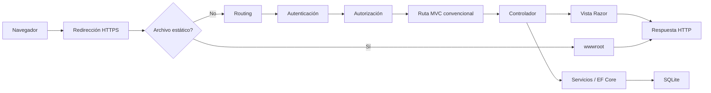

# Arquitectura

TALLER .NET es una aplicación web ASP.NET Core MVC con vistas Razor. Los controladores reciben solicitudes, coordinan servicios y acceso a datos, y devuelven vistas o redirecciones.

Documentos relacionados: [Primeros pasos](primeros-pasos.md) · [Base de datos](base-de-datos-y-migraciones.md) · [Controladores y vistas](controladores-y-vistas.md).

## Estructura

| Carpeta | Responsabilidad |
|---|---|
| `Controllers/` | Acciones MVC y respuestas HTTP. |
| `Models/` | Entidades de Identity y del dominio, enums y nombres de roles. |
| `ViewModels/` | Datos de formularios y páginas, agrupados por funcionalidad. |
| `Services/` | Operaciones de usuario y almacenamiento/validación de avatares. |
| `Data/` | `ApplicationDbContext` e inicialización de la base y datos demo. |
| `Utilities/` | Extensiones para obtener datos del usuario autenticado. |
| `Views/` | Vistas Razor organizadas por controlador y recursos compartidos. |
| `wwwroot/` | CSS, JavaScript, imágenes, librerías locales y avatares. |
| `tests/G3AspNet.Tests/` | Proyecto de pruebas automatizadas. |

## Solicitud HTTP y pipeline



Fuera de `Development`, el pipeline añade el manejador de errores y HSTS. Los formularios POST se protegen mediante un filtro global de antiforgery. Los controladores se enrutan con el patrón convencional:

```text
{controller=Home}/{action=Index}/{id?}
```

## Inyección de dependencias

- `ApplicationDbContext` se registra como scoped y usa SQLite.
- ASP.NET Core Identity usa `ApplicationDbContext` para persistir usuarios y roles.
- `UserService` es scoped.
- `ImageStorage` es singleton y recibe opciones desde la sección `FileUploads:Images`.
- `ImageStorageOptions` y `FormOptions` se configuran al iniciar la aplicación.

El detalle de entidades, cardinalidades y borrado está en [Modelo de datos](diagrama-er.md); la estructura de `Program.cs` y la política de datos están en [Base de datos y migraciones](base-de-datos-y-migraciones.md).
