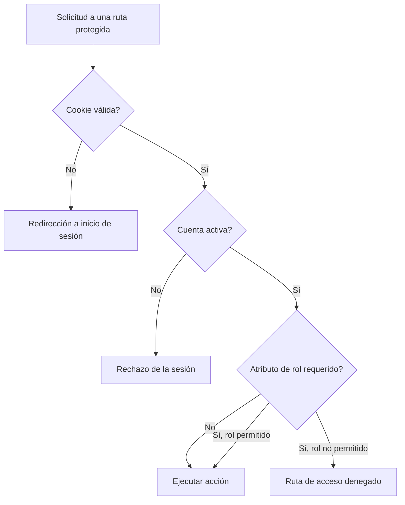

# Autenticación y roles

La aplicación usa ASP.NET Core Identity con cookies y persistencia en `ApplicationDbContext`.

Documentos relacionados: [Guía funcional](guia-funcional.md) · [Configuración](configuracion.md) · [Problemas frecuentes](problemas-frecuentes.md).

## Registro e inicio de sesión

- El registro público asigna el rol `User`; no permite escoger otro rol.
- Identity requiere correo único.
- La contraseña debe tener al menos 8 caracteres, un dígito y un carácter no alfanumérico. No se exige mayúscula ni minúscula.
- Tras 5 intentos fallidos, la cuenta se bloquea durante 10 minutos.
- La cookie de autenticación tiene una ruta de acceso denegado y se valida contra el usuario actual. Si la cuenta no existe o está inactiva, la sesión se rechaza.
- Cerrar sesión se realiza mediante POST; los formularios POST quedan cubiertos por el filtro antiforgery global.

## Roles

Los nombres definidos en `RoleNames` son `Admin`, `Mechanic`, `Customer` y `User`. El inicializador crea esos roles y asigna cuentas demo si `SeedData:Enabled` está habilitado. No publiques contraseñas de demostración ni uses esas cuentas fuera de un entorno local controlado; consulta [Demostración](demo.md) para el recorrido sin credenciales.

## Autorización observada en el código

| Área | Control actual |
|---|---|
| Administración de usuarios | `UsersController` requiere el rol `Admin`. |
| Vehículos | El controlador requiere autenticación; las operaciones de escritura se restringen a los roles de personal (`Admin` y `Mechanic`). |
| Reparaciones y piezas usadas | Los controladores requieren autenticación, pero no restringen sus acciones por rol. |
| Catálogo de recambios | `SparePartsController` no declara `[Authorize]`. |
| Perfil | Requiere autenticación. |

La visibilidad de vehículos y reparaciones también depende de la lógica de consulta. En `RepairsController`, el filtro por propietario se aplica al listado y al detalle, pero no a `Create`, `Edit`, `Delete` ni `AddPart`; `RepairPartsController` tampoco filtra por propietario. Esta limitación está señalada en la [matriz funcional](guia-funcional.md#permisos-por-perfil) y requiere confirmación del comportamiento previsto. Los controles descritos aquí reflejan el código actual; no deben interpretarse como una recomendación para un despliegue productivo.

## Flujo de acceso

