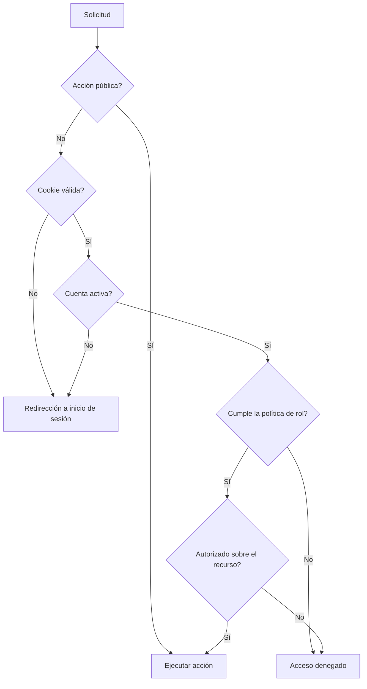

# Autenticación y roles

La aplicación usa ASP.NET Core Identity con cookies y persistencia en `ApplicationDbContext`.

Documentos relacionados: [Guía funcional](guia-funcional.md) · [Configuración](configuracion.md) · [Problemas frecuentes](problemas-frecuentes.md).

## Registro e inicio de sesión

- El registro público no pide rol: toda cuenta nueva recibe `User` y entra con la sesión iniciada.
- El inicio de sesión admite nombre de usuario o email. Las cuentas desactivadas se rechazan con el mismo mensaje que una contraseña errónea.
- Identity requiere correo único y confirmado. No se envía ningún correo: las cuentas se crean con `EmailConfirmed = true`.
- La contraseña debe tener al menos 8 caracteres, un dígito y un carácter no alfanumérico. No se exige mayúscula ni minúscula.
- Tras 5 intentos fallidos, la cuenta se bloquea durante 15 minutos.
- El login, la verificación 2FA y el registro comparten un límite de 10 peticiones POST por minuto e IP. Al superarlo se responde `429`.
- Cerrar sesión se realiza mediante POST. Todos los formularios POST quedan cubiertos por el filtro antiforgery global.
- `returnUrl` solo se sigue si es una ruta local.

## Verificación en dos pasos (2FA)

- Cualquier cuenta puede activarla en **Mi perfil → Seguridad 2FA** (`/Profile/TwoFactor`).
- La página muestra un código QR, generado en el servidor, y la clave para introducirla a mano. Se activa al validar un código de 6 dígitos.
- Con 2FA activa, tras la contraseña se pide el código en `/account/loginwith2fa`. Se puede recordar el dispositivo.
- Al desactivarla se genera una clave nueva.
- El perfil recomienda activarla a las cuentas `Admin`.
- No hay códigos de recuperación. Tampoco hay recuperación pública de contraseña: un administrador puede asignar una nueva.

## Cookie y sesión

| Opción | Valor |
|---|---|
| Nombre | `G3AspNet.Auth` |
| Duración | 8 horas, con renovación deslizante |
| `HttpOnly` | Sí |
| `SameSite` | `Lax` |
| `Secure` | Siempre fuera de `Development`; según la petición en `Development` |

La cookie se revalida contra el sello de seguridad cada 2 minutos. Cambiar el rol, el estado activo o la contraseña de una cuenta desde la administración invalida sus sesiones. Si la cuenta no existe o está inactiva, la sesión se rechaza.

## Roles

Los nombres definidos en `RoleNames` son `Admin`, `Mechanic`, `Customer` y `User`. El inicializador crea siempre esos roles, el [administrador inicial](base-de-datos-y-migraciones.md#administrador-inicial) si se configura y las cuentas demo si `SeedData:Enabled` está habilitado. La aplicación trata cada cuenta como si tuviera un único rol. No uses las cuentas de ejemplo fuera de un entorno local controlado; consulta [Demostración](demo.md).

## Autorización

Se aplica en tres niveles:

1. **Sesión obligatoria por defecto.** La `FallbackPolicy` exige un usuario autenticado salvo en las acciones `[AllowAnonymous]` (portada, errores, login, 2FA, registro y acceso denegado).
2. **Políticas por rol** ([`PolicyNames`](../Authorization/PolicyNames.cs)):

   | Política | Roles | Uso |
   |---|---|---|
   | `GestionTaller` | `Admin`, `Mechanic` | Escritura de vehículos, recambios, reparaciones y piezas usadas. |
   | `SoloAdmin` | `Admin` | Administración de usuarios, entrega y borrado de reparaciones. |

3. **Autorización por recurso.** Los controladores llaman a `IAuthorizationService` con una operación de [`WorkshopOperations`](../Authorization/WorkshopOperations.cs) y filtran sus listados con la misma regla.

| Handler | `Admin` | `Mechanic` | `Customer` y `User` |
|---|---|---|---|
| `VehicleAuthorizationHandler` | Todo | Todo | Solo leer sus vehículos |
| `RepairAuthorizationHandler` | Todo | Solo asignadas; modificar solo si están abiertas | Solo leer las de sus vehículos |
| `RepairPartAuthorizationHandler` | Todo | Solo de reparaciones asignadas; modificar solo si están abiertas | Solo leer las de sus vehículos |

Una reparación está **cerrada** cuando su estado es `Completed` o `Delivered`. El `Admin` puede modificarla, pero los controladores exigen además la confirmación `confirmClosed`.

Los accesos denegados por los handlers y los eventos de cuenta se registran con `ILogger`.

Los campos reservados al `Admin` (mecánico, tarifa por hora y precio de una pieza usada) se ignoran en el servidor si los envía un mecánico.

La tabla completa por funcionalidad está en la [guía funcional](guia-funcional.md#permisos-por-perfil).

## Flujo de acceso

