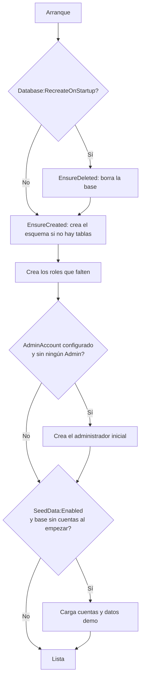

# Base de datos y migraciones

La aplicación usa Entity Framework Core con el proveedor SQLite. El contexto [`ApplicationDbContext`](../Data/ApplicationDbContext.cs) hereda de `IdentityDbContext<ApplicationUser>` y reúne las tablas de Identity y las entidades del taller.

Documentos relacionados: [Modelo de datos](diagrama-er.md) · [Arquitectura](arquitectura.md) · [Configuración](configuracion.md).

## Entidades y relaciones

- `ApplicationUser` representa las cuentas y se relaciona con sus vehículos y reparaciones asignadas a mecánicos.
- `Vehicle` tiene un propietario y puede tener varias reparaciones.
- `Repair` pertenece a un vehículo y referencia un mecánico.
- `RepairPart` enlaza una reparación con un recambio, guardando cantidad y precio unitario histórico.
- `SparePart` representa el catálogo y su stock.

`Repair` y `SparePart` forman una relación N:M mediante `RepairPart`. La configuración de borrado es `Restrict` para las relaciones históricas y `Cascade` entre `Repair` y sus líneas `RepairPart`. La matrícula (`Vehicle.LicensePlate`) y la referencia del recambio (`SparePart.Reference`) tienen índice único. El diagrama ER y las propiedades completas están en [Modelo de datos](diagrama-er.md).

## Ciclo de vida de la base

Al arrancar, [`DbInitializer`](../Data/DbInitializer.cs) sigue estos pasos:

| Clave | `appsettings.json` | `Development` |
|---|:---:|:---:|
| `Database:RecreateOnStartup` | `false` | `true` |
| `SeedData:Enabled` | `false` | `true` |

- Los perfiles `http` y `https` usan `Development`: **cada arranque local borra la base**.
- Fuera de `Development` los datos se conservan. En Docker hace falta además montar un volumen.
- Los datos demo solo se cargan en una base sin cuentas. Desactivar el seed no elimina las cuentas demo ya creadas.

### Administrador inicial

Se define con `AdminAccount:UserName`, `AdminAccount:Email` y `AdminAccount:Password`.

- Solo se crea si no existe ningún administrador. Después estos valores se ignoran y no cambian la contraseña.
- Si ya hay una cuenta con ese usuario o email, no se asciende: se registra un error y la aplicación arranca.
- Si falta alguno de los tres valores, o la contraseña no cumple las reglas, la aplicación no arranca.
- Si no se define y no hay administrador, el arranque registra un aviso.

## Migraciones

El proyecto no tiene migraciones de EF Core y no ejecuta `dotnet ef database update`, aunque [`.config/dotnet-tools.json`](../.config/dotnet-tools.json) declara la herramienta `dotnet-ef`. Los cambios de esquema se hacen en las entidades y en `ApplicationDbContext`; en `Development` el esquema se recrea al arrancar.

> [!WARNING]
> `EnsureCreated` no modifica una base que ya existe. Tras cambiar el modelo, una base con datos conservados deja de coincidir con la aplicación y se producen errores. Antes de desplegar un cambio de esquema hay que adoptar migraciones o actualizar la base a mano, con una copia de seguridad.

Para modificar una relación:

1. Actualiza la entidad en `Models/`.
2. Configura la relación y su comportamiento `OnDelete` en `ApplicationDbContext`.
3. Ajusta los datos demo en `DbInitializer`, si corresponde.
4. Actualiza las pruebas y el [diagrama ER](diagrama-er.md).

El flujo de vehículo → reparación → piezas y el ajuste de stock están descritos en el [modelo de datos](diagrama-er.md#flujo-de-datos).
