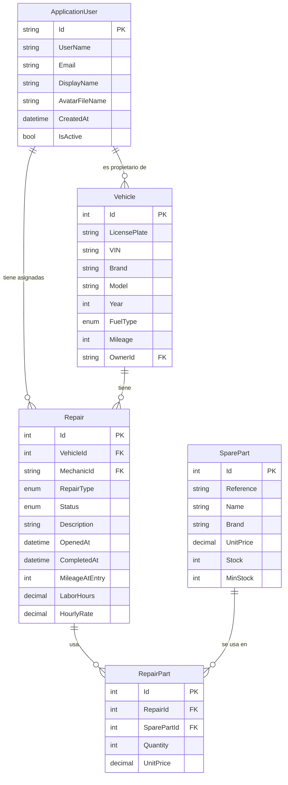
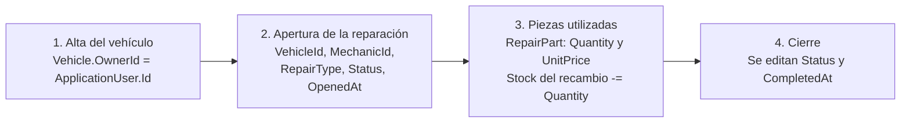

# Modelo de datos

Diagrama entidad-relación del sistema. GitHub renderiza los bloques `mermaid` de forma nativa. El esquema se crea a partir de las entidades de [`Models/`](../Models) y de la configuración de [`ApplicationDbContext`](../Data/ApplicationDbContext.cs).

Documentos relacionados: [README](../README.md) · [Guía funcional](guia-funcional.md).

## Diagrama ER



Leyenda: `PK` clave primaria, `FK` clave ajena, `||` exactamente uno, `o{` cero o muchos.

## Relaciones

| Relación | Cardinalidad | Clave ajena | Al borrar el padre |
|---|---|---|---|
| `ApplicationUser` → `Vehicle` | 1 : 0..* | `Vehicle.OwnerId` | Restringido |
| `ApplicationUser` → `Repair` | 1 : 0..* | `Repair.MechanicId` | Restringido |
| `Vehicle` → `Repair` | 1 : 0..* | `Repair.VehicleId` | Restringido |
| `Repair` → `RepairPart` | 1 : 0..* | `RepairPart.RepairId` | En cascada |
| `SparePart` → `RepairPart` | 1 : 0..* | `RepairPart.SparePartId` | Restringido |

`Repair` y `SparePart` forman una relación N:M que se resuelve con `RepairPart`. Esta tabla guarda además la cantidad y el precio unitario de cada línea.

## Entidades

Los nombres de campo son los de las propiedades C#.

### ApplicationUser

Extiende `IdentityUser`. Los campos de Identity (contraseña, roles, bloqueo) no se listan.

| Campo | Tipo | Restricciones |
|---|---|---|
| `Id` | string | PK |
| `UserName` | string | Requerido; de Identity |
| `Email` | string | Único por configuración de Identity (`RequireUniqueEmail`) |
| `DisplayName` | string | Opcional; máx. 100 caracteres |
| `AvatarFileName` | string | Opcional; máx. 260 caracteres |
| `CreatedAt` | datetime | Requerido; UTC |
| `IsActive` | bool | Por defecto `true` |

### Vehicle

| Campo | Tipo | Restricciones |
|---|---|---|
| `Id` | int | PK |
| `LicensePlate` | string | Requerido; único; máx. 10 caracteres |
| `VIN` | string | Requerido; máx. 17 caracteres |
| `Brand` | string | Requerido; máx. 50 caracteres |
| `Model` | string | Requerido; máx. 50 caracteres |
| `Year` | int | Entre 1950 y 2100 |
| `FuelType` | enum | Ver [valores](#valores-de-los-enums) |
| `Mileage` | int | Entre 0 y 2 000 000 |
| `OwnerId` | string | Requerido; FK → `ApplicationUser.Id` |

### Repair

| Campo | Tipo | Restricciones |
|---|---|---|
| `Id` | int | PK |
| `VehicleId` | int | FK → `Vehicle.Id` |
| `MechanicId` | string | FK → `ApplicationUser.Id` |
| `RepairType` | enum | Ver [valores](#valores-de-los-enums) |
| `Status` | enum | Ver [valores](#valores-de-los-enums) |
| `Description` | string | Requerido; máx. 500 caracteres |
| `OpenedAt` | datetime | Por defecto, fecha actual UTC |
| `CompletedAt` | datetime | Opcional |
| `MileageAtEntry` | int | Entre 0 y 2 000 000 |
| `LaborHours` | decimal | Entre 0 y 1000 |
| `HourlyRate` | decimal | Entre 0 y 1000 |

`TotalCost` es una propiedad calculada y no se almacena.

### SparePart

| Campo | Tipo | Restricciones |
|---|---|---|
| `Id` | int | PK |
| `Reference` | string | Requerido; único; máx. 50 caracteres |
| `Name` | string | Requerido; máx. 100 caracteres |
| `Brand` | string | Máx. 50 caracteres |
| `UnitPrice` | decimal | Entre 0 y 100 000 |
| `Stock` | int | Entre 0 y 100 000 |
| `MinStock` | int | Entre 0 y 100 000 |

### RepairPart

| Campo | Tipo | Restricciones |
|---|---|---|
| `Id` | int | PK |
| `RepairId` | int | FK → `Repair.Id` |
| `SparePartId` | int | FK → `SparePart.Id` |
| `Quantity` | int | Entre 1 y 1000 |
| `UnitPrice` | decimal | Entre 0 y 100 000; precio en el momento del uso |

## Valores de los enums

Los enums se guardan como entero, en el orden indicado a partir de 0. No hay conversión a texto configurada.

### Repair.Status

| Valor | Etiqueta en la interfaz |
|---|---|
| `Pending` | Pendiente |
| `InProgress` | En progreso |
| `WaitingParts` | Esperando repuestos |
| `Completed` | Completado |
| `Delivered` | Entregado |

### Repair.RepairType

El campo se llama `RepairType` en el código.

| Valor | Etiqueta en la interfaz |
|---|---|
| `OilChange` | Cambio de aceite |
| `GeneralInspection` | Inspección general |
| `BrakeFluidChange` | Cambio de líquido de frenos |
| `Tires` | Neumáticos |
| `Bodywork` | Carrocería |
| `Painting` | Pintura |
| `Other` | Otro |

### Vehicle.FuelType

| Valor | Etiqueta en la interfaz |
|---|---|
| `Petrol` | Gasolina |
| `Diesel` | Diésel |
| `Hybrid` | Híbrido |
| `Electric` | Eléctrico |
| `LPG` | GLP |

## Flujo de datos



1. Un vehículo pertenece a una cuenta mediante `Vehicle.OwnerId`.
2. Una reparación referencia el vehículo y la cuenta del mecánico asignado.
3. Cada pieza usada es una fila de `RepairPart`. La aplicación descuenta `SparePart.Stock` al guardarla.
4. Al terminar, se editan `Status` y `CompletedAt` en el formulario de la reparación.

El descuento de stock lo hace la lógica de la aplicación en `Repair.AddPart` y en los controladores. La base de datos no lo gestiona.

### Cálculo del coste

```text
Coste = (LaborHours × HourlyRate) + Σ(Quantity × UnitPrice)
```
