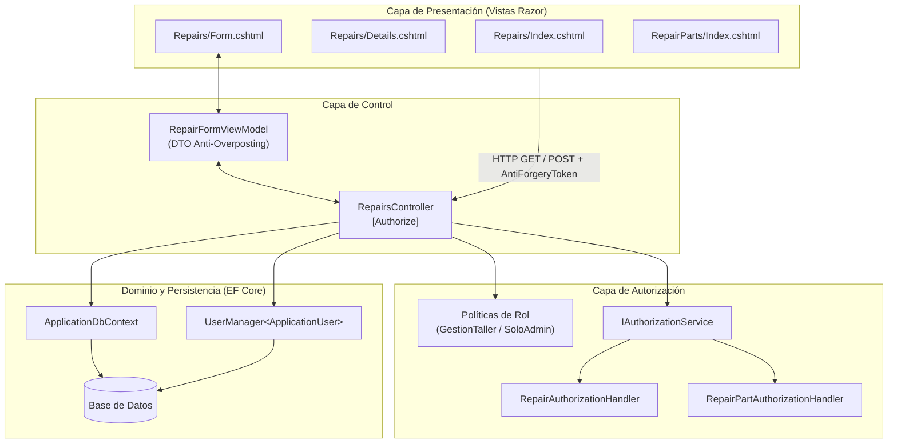
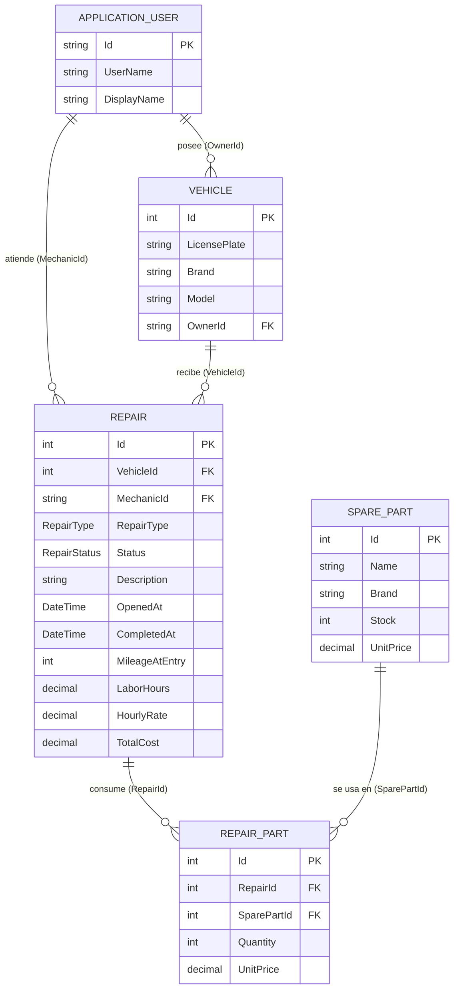
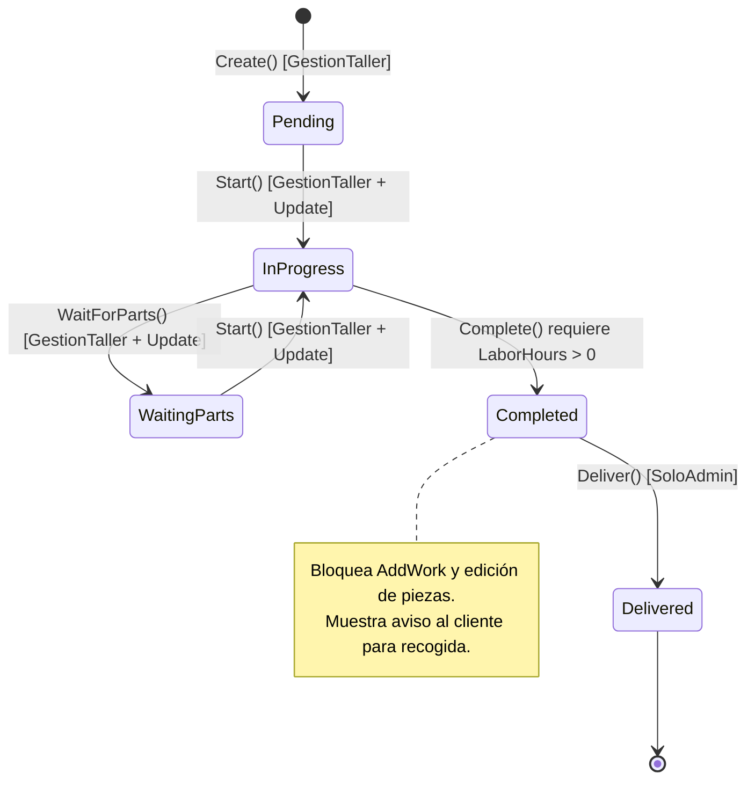
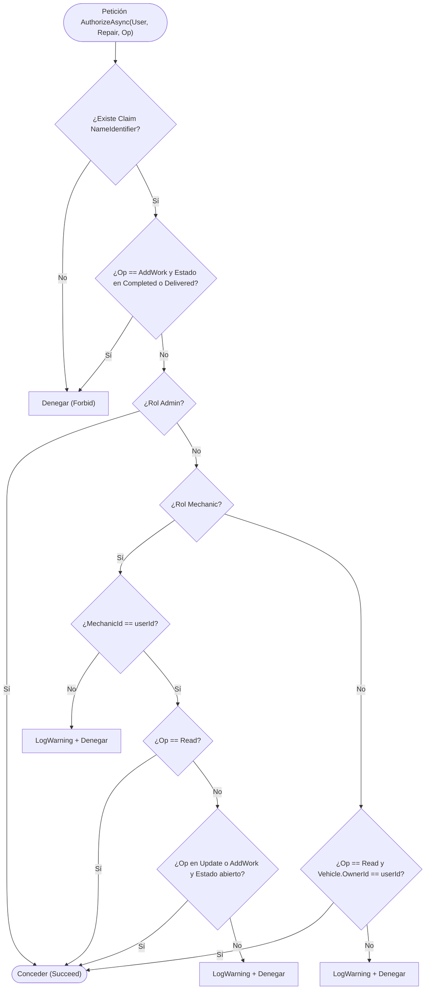
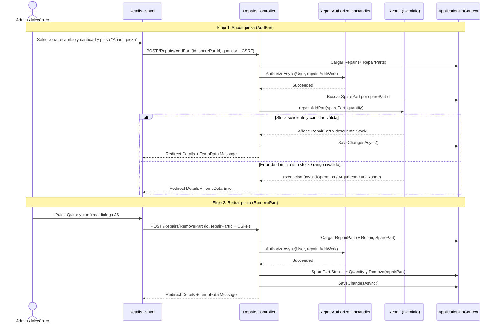

# 1. Introducción y Visión General

Este documento recoge y explica la implementación del **módulo de gestión de reparaciones y recambios** de la aplicación **G3AspNet**, desarrollada con **ASP.NET Core MVC** y **Entity Framework Core**.

El módulo está diseñado siguiendo principios sólidos de arquitectura y seguridad web:

* **Patrón MVC + ViewModels (DTOs):** Se evita exponer directamente las entidades de base de datos en los formularios de entrada (`RepairFormViewModel`), mitigando ataques de *overposting* (OWASP API3:2023).

* **Autorización en dos niveles:** Combina políticas basadas en roles (`GestionTaller`, `SoloAdmin`) con **autorización basada en recursos** (`IAuthorizationService` y `AuthorizationHandler`) para validar permisos según el usuario, la propiedad del recurso y el estado de la reparación.

* **Máquina de estados controlada:** El ciclo de vida de una orden de reparación no se edita libremente desde un desplegable, sino mediante acciones `POST` específicas con validaciones de negocio.

* **Integridad del inventario:** Añadir, retirar o eliminar reparaciones actualiza automáticamente el stock de los recambios (`SpareParts`).

# 2. Arquitectura y Modelo de Datos

## 2.1. Arquitectura de Capas del Módulo

El siguiente diagrama muestra cómo interactúan las vistas Razor, el controlador, la capa de autorización y el contexto de Entity Framework Core ante una petición HTTP:



## 2.2. Diagrama Entidad–Relación (Modelo del Dominio)

A partir de las propiedades navegadas en el controlador, los handlers y las vistas, la estructura relacional del módulo de reparaciones es la siguiente:



# 3. Ciclo de Vida de una Reparación (Máquina de Estados)

El estado de una reparación (`RepairStatus`) sigue un flujo estricto gestionado desde los botones de la vista de detalle y validado en `RepairsController`:



| Transición | Acción POST | Política / Permiso | Reglas de negocio y efectos |
| ----- | ----- | ----- | ----- |
| `Pending` / `WaitingParts` → `InProgress` | `Start` | `GestionTaller` + `Update` | Inicia una orden nueva o retoma una pausada por recambios. |
| `InProgress` → `WaitingParts` | `WaitForParts` | `GestionTaller` + `Update` | Pausa la reparación a la espera de piezas. |
| `InProgress` → `Completed` | `Complete` | `GestionTaller` + `Update` | Exige LaborHours > 0. Registra `CompletedAt = DateTime.UtcNow`. Bloquea la adición/retirada de piezas y avisa al cliente. |
| `Completed` → `Delivered` | `Deliver` | `SoloAdmin` | Marca el vehículo como entregado y cierra definitivamente la orden. |

# 4. Autorización, Seguridad y Flujos Clave

## 4.1. Matriz de Permisos por Rol

El acceso a los datos está controlado tanto en consultas (`VisibleRepairs()`) como en operaciones puntuales mediante `RepairAuthorizationHandler` y `RepairPartAuthorizationHandler`.

| Rol | `Read` (Ver) | `Create` (Crear) | `Update` (Editar / Estados) | `AddWork` / Modificar piezas | `Delete` (Eliminar) |
| ----- | ----- | ----- | ----- | ----- | ----- |
| **Admin** | Todas las reparaciones | Sí (elige mecánico y tarifa) | Todas las reparaciones | Solo si **no** está `Completed` ni `Delivered` | Todas (devuelve stock) |
| **Mechanic** | Solo reparaciones asignadas | Sí (autoasignado y tarifa fija 45 €/h) | Solo asignadas y **no** cerradas (`Completed` / `Delivered`) | Solo asignadas y **no** cerradas | No permitido |
| **Customer / User** | Solo reparaciones de sus propios vehículos (`OwnerId`) | No permitido | No permitido | No permitido | No permitido |

> **Nota de seguridad:** Incluso para el rol `Admin`, las operaciones de modificación de piezas (`AddWork` en `Repair` y `Create/Update/Delete` en `RepairPart`) quedan bloqueadas cuando la reparación alcanza el estado `Completed` o `Delivered`, garantizando la integridad contable y de facturación una vez cerrado el trabajo.

## 4.2. Diagrama de Decisión de `RepairAuthorizationHandler`

Este flujo resume la evaluación exacta que ejecuta `HandleRequirementAsync` para conceder o denegar el acceso sobre una entidad `Repair`:



## 4.3. Diagrama de Secuencia: Gestión de Piezas e Inventario

El siguiente diagrama detalla el flujo **PRG (Post–Redirect–Get)** cuando un técnico añade o retira una pieza desde `Details.cshtml`, garantizando la sincronización con el stock:



# 5. Análisis Detallado por Componente

## 5.1. Controlador de Reparaciones (`RepairsController.cs`)

### Explicación técnica

`RepairsController` centraliza el CRUD completo, las transiciones de estado y la gestión rápida de recambios asociados a una reparación:

1. **Inyección de dependencias:** Recibe `ApplicationDbContext` (acceso a datos), `UserManager<ApplicationUser>` (consulta de mecánicos por rol) e `IAuthorizationService` (evaluación de permisos por recurso).

2. **Filtrado de visibilidad (`VisibleRepairs`):** Aplica el principio de mínimo privilegio directamente sobre la consulta `IQueryable<Repair>` antes de materializar los datos en memoria.

3. **Carga previa en `Details`:** Utiliza `.Include()` y `.ThenInclude()` para traer vehículo, mecánico y piezas en una sola consulta. Además, evalúa `Update`, `Delete` y `AddWork` para pasar banderas booleanas a la vista (`ViewBag`) y solo consulta los recambios con `Stock > 0` (con `.AsNoTracking()`) si el usuario tiene permiso `canAddWork`.

4. **Protección contra *Overposting* (`Create` y `Edit`):** Si un usuario con rol `Mechanic` intenta manipular la petición HTTP para reasignar la orden a otro mecánico o alterar la tarifa por hora (`HourlyRate`), el controlador sobrescribe estos valores en el servidor y limpia los errores de `ModelState` correspondientes.

5. **Consistencia de inventario:**

   * En `AddPart`, delega la lógica de negocio al método de dominio `repair.AddPart(sparePart, quantity)`, capturando excepciones de dominio para mostrarlas en `TempData["Error"]`.

   * En `RemovePart` y `DeleteConfirmed`, devuelve al stock del almacén (`Stock += Quantity`) las unidades que estaban reservadas en la reparación.

6. **Seguridad CSRF:** Todas las acciones que modifican estado (`POST`) están protegidas con `[ValidateAntiForgeryToken]`.

### Código fuente

```csharp
using G3AspNet.Authorization;
using G3AspNet.Data;
using G3AspNet.Models;
using G3AspNet.Models.Enum;
using G3AspNet.Utilities;
using G3AspNet.ViewModels.Repairs;
using Microsoft.AspNetCore.Authorization;
using Microsoft.AspNetCore.Identity;
using Microsoft.AspNetCore.Mvc;
using Microsoft.AspNetCore.Mvc.Rendering;
using Microsoft.EntityFrameworkCore;

namespace G3AspNet.Controllers;

[Authorize]
/// <summary>Gestiona la consulta, creación, edición y eliminación de reparaciones con autorización por recurso.</summary>
public class RepairsController : Controller
{
    private readonly ApplicationDbContext context;
    private readonly UserManager<ApplicationUser> userManager;
    private readonly IAuthorizationService authorizationService;

    public RepairsController(
        ApplicationDbContext context,
        UserManager<ApplicationUser> userManager,
        IAuthorizationService authorizationService)
    {
        this.context = context;
        this.userManager = userManager;
        this.authorizationService = authorizationService;
    }

    private async Task PopulateDropdownsAsync(RepairFormViewModel? repair = null)
    {
        var vehicles = await context.Vehicles
            .OrderBy(v => v.LicensePlate)
            .Select(v => new { v.Id, Description = $"{v.LicensePlate} - {v.Brand} {v.Model}" })
            .ToListAsync();
        ViewBag.Vehicles = new SelectList(vehicles, "Id", "Description", repair?.VehicleId);

        var mechanics = await userManager.GetUsersInRoleAsync(RoleNames.Mechanic);
        ViewBag.Mechanics = new SelectList(mechanics.OrderBy(m => m.DisplayName ?? m.UserName).Select(m => new
        {
            m.Id,
            Name = m.DisplayName ?? m.UserName
        }), "Id", "Name", repair?.MechanicId);
    }

    // Admin ve todas; Mechanic solo sus asignadas; Customer y User solo reparaciones de sus propios vehículos.
    private IQueryable<Repair> VisibleRepairs()
    {
        var query = context.Repairs.AsQueryable();

        if (User.IsInRole(RoleNames.Admin))
        {
            return query;
        }

        var userId = User.GetRequiredUserId();
        if (User.IsInRole(RoleNames.Mechanic))
        {
            return query.Where(r => r.MechanicId == userId);
        }

        return query.Where(r => r.Vehicle.OwnerId == userId);
    }

    /// <summary>Lista las reparaciones accesibles para el usuario actual.</summary>
    [HttpGet]
    public async Task<IActionResult> Index()
    {
        var repairs = await VisibleRepairs()
            .Include(repair => repair.Vehicle)
            .Include(repair => repair.Mechanic)
            .OrderByDescending(repair => repair.OpenedAt)
            .ToListAsync();

        return View(repairs);
    }

    /// <summary>Muestra el detalle de una reparación tras validar autorización sobre el recurso.</summary>
    [HttpGet]
    public async Task<IActionResult> Details(int id)
    {
        var repair = await context.Repairs
            .Include(repair => repair.Vehicle)
            .Include(repair => repair.Mechanic)
            .Include(repair => repair.RepairParts)
            .ThenInclude(repairPart => repairPart.SparePart)
            .FirstOrDefaultAsync(repair => repair.Id == id);

        if (repair == null)
        {
            return NotFound();
        }

        var readAuth = await authorizationService.AuthorizeAsync(User, repair, WorkshopOperations.Read);
        if (!readAuth.Succeeded)
        {
            return Forbid();
        }

        var canEdit = (await authorizationService.AuthorizeAsync(User, repair, WorkshopOperations.Update)).Succeeded;
        var canDelete = (await authorizationService.AuthorizeAsync(User, repair, WorkshopOperations.Delete)).Succeeded;
        var canAddWork = (await authorizationService.AuthorizeAsync(User, repair, WorkshopOperations.AddWork)).Succeeded;

        ViewBag.CanEdit = canEdit;
        ViewBag.CanDelete = canDelete;
        ViewBag.CanAddWork = canAddWork;

        if (canAddWork)
        {
            ViewBag.AvailableSpareParts = new SelectList(
                await context.SpareParts
                    .AsNoTracking()
                    .Where(sp => sp.Stock > 0)
                    .OrderBy(sp => sp.Name)
                    .Select(sp => new
                    {
                        sp.Id,
                        Description = $"{sp.Name} - {sp.Brand} (Stock: {sp.Stock} · {sp.UnitPrice:N2} €)"
                    })
                    .ToListAsync(),
                "Id",
                "Description");
        }

        return View(repair);
    }

    /// <summary>Muestra el formulario para dar de alta una nueva reparación.</summary>
    [HttpGet]
    [Authorize(Policy = PolicyNames.GestionTaller)]
    public async Task<IActionResult> Create()
    {
        var model = new RepairFormViewModel
        {
            CompletedAt = null,
            MechanicId = User.IsInRole(RoleNames.Admin) ? string.Empty : User.GetRequiredUserId(),
            HourlyRate = 45m
        };
        await PopulateDropdownsAsync(model);
        return View("Form", model);
    }

    /// <summary>Registra una nueva reparación usando DTO anti-overposting.</summary>
    [HttpPost]
    [ValidateAntiForgeryToken]
    [Authorize(Policy = PolicyNames.GestionTaller)]
    public async Task<IActionResult> Create(RepairFormViewModel model)
    {
        var isAdmin = User.IsInRole(RoleNames.Admin);
        if (!isAdmin)
        {
            // Un mecánico solo puede crear órdenes asignadas a sí mismo y con tarifa estándar.
            model.MechanicId = User.GetRequiredUserId();
            model.HourlyRate = 45m;
            ModelState.Remove(nameof(RepairFormViewModel.MechanicId));
            ModelState.Remove(nameof(RepairFormViewModel.HourlyRate));
        }
        else if (string.IsNullOrWhiteSpace(model.MechanicId))
        {
            ModelState.AddModelError(nameof(RepairFormViewModel.MechanicId), "Debes seleccionar un mecánico.");
        }

        if (!await context.Vehicles.AnyAsync(v => v.Id == model.VehicleId))
        {
            ModelState.AddModelError(nameof(RepairFormViewModel.VehicleId), "El vehículo seleccionado no existe.");
        }

        if (!string.IsNullOrWhiteSpace(model.MechanicId) && !await context.Users.AnyAsync(u => u.Id == model.MechanicId))
        {
            ModelState.AddModelError(nameof(RepairFormViewModel.MechanicId), "El mecánico seleccionado no existe.");
        }

        if (!ModelState.IsValid)
        {
            await PopulateDropdownsAsync(model);
            return View("Form", model);
        }

        var repair = new Repair
        {
            VehicleId = model.VehicleId,
            MechanicId = model.MechanicId,
            RepairType = model.RepairType,
            Status = RepairStatus.Pending,
            Description = model.Description.Trim(),
            OpenedAt = model.OpenedAt,
            CompletedAt = null,
            MileageAtEntry = model.MileageAtEntry,
            LaborHours = model.LaborHours,
            HourlyRate = model.HourlyRate
        };

        context.Repairs.Add(repair);
        await context.SaveChangesAsync();

        TempData["Message"] = "Reparación creada correctamente.";
        return RedirectToAction(nameof(Details), new { id = repair.Id });
    }

    /// <summary>Muestra el formulario para editar una reparación existente tras validar el recurso.</summary>
    [HttpGet]
    [Authorize(Policy = PolicyNames.GestionTaller)]
    public async Task<IActionResult> Edit(int id)
    {
        var repair = await context.Repairs
            .Include(r => r.Vehicle)
            .Include(r => r.Mechanic)
            .FirstOrDefaultAsync(r => r.Id == id);

        if (repair == null)
        {
            return NotFound();
        }

        var authResult = await authorizationService.AuthorizeAsync(User, repair, WorkshopOperations.Update);
        if (!authResult.Succeeded)
        {
            return Forbid();
        }

        var model = new RepairFormViewModel
        {
            Id = repair.Id,
            VehicleId = repair.VehicleId,
            MechanicId = repair.MechanicId,
            RepairType = repair.RepairType,
            Status = repair.Status,
            Description = repair.Description,
            OpenedAt = repair.OpenedAt,
            CompletedAt = repair.CompletedAt,
            MileageAtEntry = repair.MileageAtEntry,
            LaborHours = repair.LaborHours,
            HourlyRate = repair.HourlyRate
        };

        await PopulateDropdownsAsync(model);
        return View("Form", model);
    }

    /// <summary>Actualiza los datos permitidos de una reparación existente.</summary>
    [HttpPost]
    [ValidateAntiForgeryToken]
    [Authorize(Policy = PolicyNames.GestionTaller)]
    public async Task<IActionResult> Edit(int id, RepairFormViewModel model)
    {
        if (id != model.Id)
        {
            return BadRequest();
        }

        var repair = await context.Repairs.FindAsync(id);
        if (repair == null)
        {
            return NotFound();
        }

        var authResult = await authorizationService.AuthorizeAsync(User, repair, WorkshopOperations.Update);
        if (!authResult.Succeeded)
        {
            return Forbid();
        }

        var isAdmin = User.IsInRole(RoleNames.Admin);
        if (!isAdmin)
        {
            // Protege campos reservados a Admin frente a overposting (API3:2023).
            model.MechanicId = repair.MechanicId;
            model.HourlyRate = repair.HourlyRate;
            ModelState.Remove(nameof(RepairFormViewModel.MechanicId));
            ModelState.Remove(nameof(RepairFormViewModel.HourlyRate));
        }
        else if (string.IsNullOrWhiteSpace(model.MechanicId))
        {
            ModelState.AddModelError(nameof(RepairFormViewModel.MechanicId), "Debes seleccionar un mecánico.");
        }

        if (!await context.Vehicles.AnyAsync(v => v.Id == model.VehicleId))
        {
            ModelState.AddModelError(nameof(RepairFormViewModel.VehicleId), "El vehículo seleccionado no existe.");
        }

        if (!ModelState.IsValid)
        {
            model.Status = repair.Status;
            model.CompletedAt = repair.CompletedAt;
            await PopulateDropdownsAsync(model);
            return View("Form", model);
        }

        repair.VehicleId = model.VehicleId;
        repair.RepairType = model.RepairType;
        repair.OpenedAt = model.OpenedAt;
        repair.MileageAtEntry = model.MileageAtEntry;
        repair.LaborHours = model.LaborHours;
        repair.Description = model.Description.Trim();

        if (isAdmin)
        {
            repair.MechanicId = model.MechanicId;
            repair.HourlyRate = model.HourlyRate;
        }

        await context.SaveChangesAsync();

        TempData["Message"] = "Reparación actualizada correctamente.";
        return RedirectToAction(nameof(Details), new { id = repair.Id });
    }

    /// <summary>Muestra la confirmación para eliminar una reparación (solo Admin).</summary>
    [HttpGet]
    [Authorize(Policy = PolicyNames.SoloAdmin)]
    public async Task<IActionResult> Delete(int id)
    {
        var repair = await context.Repairs
            .Include(r => r.Vehicle)
            .Include(r => r.Mechanic)
            .Include(r => r.RepairParts)
            .ThenInclude(rp => rp.SparePart)
            .FirstOrDefaultAsync(r => r.Id == id);

        if (repair == null)
        {
            return NotFound();
        }

        var authResult = await authorizationService.AuthorizeAsync(User, repair, WorkshopOperations.Delete);
        if (!authResult.Succeeded)
        {
            return Forbid();
        }

        return View(repair);
    }

    /// <summary>Elimina la reparación y devuelve al inventario el stock de las piezas asociadas (solo Admin).</summary>
    [HttpPost, ActionName("Delete")]
    [ValidateAntiForgeryToken]
    [Authorize(Policy = PolicyNames.SoloAdmin)]
    public async Task<IActionResult> DeleteConfirmed(int id)
    {
        var repair = await context.Repairs
            .Include(r => r.RepairParts)
            .ThenInclude(rp => rp.SparePart)
            .FirstOrDefaultAsync(r => r.Id == id);

        if (repair == null)
        {
            return NotFound();
        }

        var authResult = await authorizationService.AuthorizeAsync(User, repair, WorkshopOperations.Delete);
        if (!authResult.Succeeded)
        {
            return Forbid();
        }

        foreach (var part in repair.RepairParts)
        {
            if (part.SparePart != null)
            {
                part.SparePart.Stock += part.Quantity;
            }
        }

        context.Repairs.Remove(repair);
        await context.SaveChangesAsync();

        TempData["Message"] = "Reparación eliminada correctamente.";
        return RedirectToAction(nameof(Index));
    }

    [HttpPost]
    [ValidateAntiForgeryToken]
    [Authorize(Policy = PolicyNames.GestionTaller)]
    public async Task<IActionResult> Start(int id)
    {
        var repair = await context.Repairs.FirstOrDefaultAsync(r => r.Id == id);
        if (repair == null)
        {
            return NotFound();
        }

        var authResult = await authorizationService.AuthorizeAsync(User, repair, WorkshopOperations.Update);
        if (!authResult.Succeeded)
        {
            return Forbid();
        }

        if (repair.Status != RepairStatus.Pending && repair.Status != RepairStatus.WaitingParts)
        {
            TempData["Error"] = "Solo se puede iniciar una reparación pendiente o retomar una que espera recambios.";
            return RedirectToAction(nameof(Details), new { id });
        }

        repair.Status = RepairStatus.InProgress;
        await context.SaveChangesAsync();

        TempData["Message"] = "Reparación en progreso.";
        return RedirectToAction(nameof(Details), new { id });
    }

    [HttpPost]
    [ValidateAntiForgeryToken]
    [Authorize(Policy = PolicyNames.GestionTaller)]
    public async Task<IActionResult> WaitForParts(int id)
    {
        var repair = await context.Repairs.FirstOrDefaultAsync(r => r.Id == id);
        if (repair == null)
        {
            return NotFound();
        }

        var authResult = await authorizationService.AuthorizeAsync(User, repair, WorkshopOperations.Update);
        if (!authResult.Succeeded)
        {
            return Forbid();
        }

        if (repair.Status != RepairStatus.InProgress)
        {
            TempData["Error"] = "Solo se puede esperar recambios en una reparación en progreso.";
            return RedirectToAction(nameof(Details), new { id });
        }

        repair.Status = RepairStatus.WaitingParts;
        await context.SaveChangesAsync();

        TempData["Message"] = "Reparación en espera de recambios.";
        return RedirectToAction(nameof(Details), new { id });
    }

    [HttpPost]
    [ValidateAntiForgeryToken]
    [Authorize(Policy = PolicyNames.GestionTaller)]
    public async Task<IActionResult> Complete(int id)
    {
        var repair = await context.Repairs
            .Include(r => r.RepairParts)
            .FirstOrDefaultAsync(r => r.Id == id);
        if (repair == null)
        {
            return NotFound();
        }

        var authResult = await authorizationService.AuthorizeAsync(User, repair, WorkshopOperations.Update);
        if (!authResult.Succeeded)
        {
            return Forbid();
        }

        if (repair.Status != RepairStatus.InProgress)
        {
            TempData["Error"] = "Solo se puede completar una reparación en progreso.";
            return RedirectToAction(nameof(Details), new { id });
        }

        if (repair.LaborHours <= 0)
        {
            TempData["Error"] = "Apunta las horas de mano de obra antes de completar la reparación.";
            return RedirectToAction(nameof(Details), new { id });
        }

        repair.Status = RepairStatus.Completed;
        repair.CompletedAt = DateTime.UtcNow;
        await context.SaveChangesAsync();

        TempData["Message"] = $"Reparación completada. Coste total: {repair.TotalCost:N2} €.";
        return RedirectToAction(nameof(Details), new { id });
    }

    [HttpPost]
    [ValidateAntiForgeryToken]
    [Authorize(Policy = PolicyNames.SoloAdmin)]
    public async Task<IActionResult> Deliver(int id)
    {
        var repair = await context.Repairs.FirstOrDefaultAsync(r => r.Id == id);
        if (repair == null)
        {
            return NotFound();
        }

        if (repair.Status != RepairStatus.Completed)
        {
            TempData["Error"] = "Solo se puede entregar una reparación completada.";
            return RedirectToAction(nameof(Details), new { id });
        }

        repair.Status = RepairStatus.Delivered;
        await context.SaveChangesAsync();

        TempData["Message"] = "Vehículo entregado al cliente. La reparación queda cerrada.";
        return RedirectToAction(nameof(Details), new { id });
    }

    /// <summary>Añade un recambio a la reparación autorizada y descuenta la cantidad del stock disponible.</summary>
    [HttpPost]
    [ValidateAntiForgeryToken]
    [Authorize(Policy = PolicyNames.GestionTaller)]
    public async Task<IActionResult> AddPart(int id, int sparePartId, int quantity)
    {
        var repair = await context.Repairs
            .Include(r => r.RepairParts)
            .FirstOrDefaultAsync(r => r.Id == id);

        if (repair == null)
        {
            return NotFound();
        }

        var authResult = await authorizationService.AuthorizeAsync(User, repair, WorkshopOperations.AddWork);
        if (!authResult.Succeeded)
        {
            return Forbid();
        }

        if (sparePartId <= 0)
        {
            TempData["Error"] = "Debes seleccionar un recambio válido.";
            return RedirectToAction(nameof(Details), new { id });
        }

        var sparePart = await context.SpareParts.FindAsync(sparePartId);
        if (sparePart == null)
        {
            return NotFound();
        }

        try
        {
            repair.AddPart(sparePart, quantity);
            await context.SaveChangesAsync();
            TempData["Message"] = "Pieza añadida correctamente.";
        }
        catch (Exception ex) when (ex is ArgumentOutOfRangeException or InvalidOperationException)
        {
            TempData["Error"] = ex.Message;
        }

        return RedirectToAction(nameof(Details), new { id });
    }

    /// <summary>Quita una pieza asignada a la reparación autorizada y devuelve las unidades al stock.</summary>
    [HttpPost]
    [ValidateAntiForgeryToken]
    [Authorize(Policy = PolicyNames.GestionTaller)]
    public async Task<IActionResult> RemovePart(int id, int repairPartId)
    {
        var repairPart = await context.RepairParts
            .Include(rp => rp.Repair)
            .Include(rp => rp.SparePart)
            .FirstOrDefaultAsync(rp => rp.Id == repairPartId && rp.RepairId == id);

        if (repairPart == null)
        {
            return NotFound();
        }

        var authResult = await authorizationService.AuthorizeAsync(User, repairPart.Repair, WorkshopOperations.AddWork);
        if (!authResult.Succeeded)
        {
            return Forbid();
        }

        repairPart.SparePart.Stock += repairPart.Quantity;
        context.RepairParts.Remove(repairPart);
        await context.SaveChangesAsync();

        TempData["Message"] = "Pieza retirada de la reparación y stock restablecido.";
        return RedirectToAction(nameof(Details), new { id });
    }
}
```

## 5.2. Handlers de Autorización Basada en Recursos

### Explicación técnica

Ambos manejadores heredan de `AuthorizationHandler<OperationAuthorizationRequirement, TResource>` y permiten tomar decisiones de autorización que dependen de los datos concretos de la entidad consultada (mitigando vulnerabilidades **IDOR / BOLA**):

* **`RepairAuthorizationHandler`:** comprueba el claim `NameIdentifier`, impide `AddWork` si la reparación está `Completed` o `Delivered`, concede control al `Admin`, restringe al `Mechanic` a órdenes asignadas y abiertas, y permite `Read` al cliente propietario del vehículo.
* **`RepairPartAuthorizationHandler`:** aplica reglas equivalentes sobre cada línea de recambio navegando hacia `resource.Repair` y bloquea cualquier operación distinta de `Read` cuando la reparación padre está cerrada.

### Código fuente: `RepairAuthorizationHandler.cs`

```csharp
using System.Security.Claims;
using G3AspNet.Models;
using G3AspNet.Models.Enum;
using Microsoft.AspNetCore.Authorization;
using Microsoft.AspNetCore.Authorization.Infrastructure;

namespace G3AspNet.Authorization;

/// <summary>
/// Autorización basada en recurso para órdenes de reparación:
/// Admin tiene control total salvo añadir trabajo en órdenes completadas o entregadas;
/// Mechanic solo sobre sus órdenes asignadas y abiertas;
/// Customer y User solo lectura sobre reparaciones de sus propios vehículos.
/// </summary>
public sealed class RepairAuthorizationHandler
    : AuthorizationHandler<OperationAuthorizationRequirement, Repair>
{
    private readonly ILogger<RepairAuthorizationHandler> logger;

    public RepairAuthorizationHandler(ILogger<RepairAuthorizationHandler> logger)
    {
        this.logger = logger;
    }

    protected override Task HandleRequirementAsync(
        AuthorizationHandlerContext context,
        OperationAuthorizationRequirement requirement,
        Repair resource)
    {
        var userId = context.User.FindFirstValue(ClaimTypes.NameIdentifier);
        if (string.IsNullOrEmpty(userId))
        {
            return Task.CompletedTask;
        }

        if (requirement.Name == WorkshopOperations.AddWork.Name &&
            resource.Status is RepairStatus.Completed or RepairStatus.Delivered)
        {
            return Task.CompletedTask;
        }

        if (context.User.IsInRole(RoleNames.Admin))
        {
            context.Succeed(requirement);
            return Task.CompletedTask;
        }

        if (context.User.IsInRole(RoleNames.Mechanic))
        {
            var isAssigned = resource.MechanicId == userId;
            if (!isAssigned)
            {
                logger.LogWarning(
                    "Mecánico {UserId} intentó operación {Operation} sobre reparación no asignada {RepairId}.",
                    userId, requirement.Name, resource.Id);
                return Task.CompletedTask;
            }

            if (requirement.Name == WorkshopOperations.Read.Name)
            {
                context.Succeed(requirement);
                return Task.CompletedTask;
            }

            if ((requirement.Name == WorkshopOperations.Update.Name ||
                 requirement.Name == WorkshopOperations.AddWork.Name) &&
                resource.Status is not (RepairStatus.Completed or RepairStatus.Delivered))
            {
                context.Succeed(requirement);
                return Task.CompletedTask;
            }

            logger.LogWarning(
                "Mecánico {UserId} denegado en operación {Operation} sobre reparación {RepairId} (estado {Status}).",
                userId, requirement.Name, resource.Id, resource.Status);
            return Task.CompletedTask;
        }

        if (requirement.Name == WorkshopOperations.Read.Name &&
            resource.Vehicle is not null &&
            resource.Vehicle.OwnerId == userId)
        {
            context.Succeed(requirement);
            return Task.CompletedTask;
        }

        logger.LogWarning(
            "Acceso denegado a Repair {RepairId} para usuario {UserId} en operación {Operation}.",
            resource.Id, userId, requirement.Name);

        return Task.CompletedTask;
    }
}
```

### Código fuente: `RepairPartAuthorizationHandler.cs`

```csharp
using System.Security.Claims;
using G3AspNet.Models;
using G3AspNet.Models.Enum;
using Microsoft.AspNetCore.Authorization;
using Microsoft.AspNetCore.Authorization.Infrastructure;

namespace G3AspNet.Authorization;

/// <summary>
/// Autorización basada en recurso para líneas de piezas usadas en una reparación.
/// </summary>
public sealed class RepairPartAuthorizationHandler
    : AuthorizationHandler<OperationAuthorizationRequirement, RepairPart>
{
    private readonly ILogger<RepairPartAuthorizationHandler> logger;

    public RepairPartAuthorizationHandler(ILogger<RepairPartAuthorizationHandler> logger)
    {
        this.logger = logger;
    }

    protected override Task HandleRequirementAsync(
        AuthorizationHandlerContext context,
        OperationAuthorizationRequirement requirement,
        RepairPart resource)
    {
        var userId = context.User.FindFirstValue(ClaimTypes.NameIdentifier);
        if (string.IsNullOrEmpty(userId))
        {
            return Task.CompletedTask;
        }

        var repairIsClosed = resource.Repair?.Status is RepairStatus.Completed or RepairStatus.Delivered;
        if (repairIsClosed && requirement.Name != WorkshopOperations.Read.Name)
        {
            return Task.CompletedTask;
        }

        if (context.User.IsInRole(RoleNames.Admin))
        {
            context.Succeed(requirement);
            return Task.CompletedTask;
        }

        if (context.User.IsInRole(RoleNames.Mechanic))
        {
            var isAssigned = resource.Repair is not null && resource.Repair.MechanicId == userId;
            if (!isAssigned)
            {
                logger.LogWarning(
                    "Mecánico {UserId} intentó operación {Operation} sobre RepairPart {RepairPartId} de reparación ajena.",
                    userId, requirement.Name, resource.Id);
                return Task.CompletedTask;
            }

            if (requirement.Name == WorkshopOperations.Read.Name)
            {
                context.Succeed(requirement);
                return Task.CompletedTask;
            }

            if ((requirement.Name == WorkshopOperations.Create.Name ||
                 requirement.Name == WorkshopOperations.Update.Name ||
                 requirement.Name == WorkshopOperations.Delete.Name) &&
                resource.Repair!.Status is not (RepairStatus.Completed or RepairStatus.Delivered))
            {
                context.Succeed(requirement);
                return Task.CompletedTask;
            }

            return Task.CompletedTask;
        }

        if (requirement.Name == WorkshopOperations.Read.Name &&
            resource.Repair?.Vehicle is not null &&
            resource.Repair.Vehicle.OwnerId == userId)
        {
            context.Succeed(requirement);
            return Task.CompletedTask;
        }

        logger.LogWarning(
            "Acceso denegado a RepairPart {RepairPartId} para usuario {UserId} en operación {Operation}.",
            resource.Id, userId, requirement.Name);

        return Task.CompletedTask;
    }
}
```

## 5.3. Vista de Detalle de Reparación (`Views/Repairs/Details.cshtml`)

### Explicación técnica

Es la pantalla principal de trabajo de una reparación: desglose económico, aviso al cliente cuando el estado es `Completed`, botones de transición de estado y gestión de piezas con patrón PRG y token antifalsificación.

### Código fuente

```html
@using G3AspNet.Models.Enum
@model Repair
@{
    ViewData["Title"] = $"Reparación #{Model.Id}";
    var laborCost = Model.LaborHours * Model.HourlyRate;
    var canEdit = ViewBag.CanEdit as bool? ?? false;
    var canDelete = ViewBag.CanDelete as bool? ?? false;
    var canAddWork = ViewBag.CanAddWork as bool? ?? false;
    var isAdmin = User.IsInRole(RoleNames.Admin);
    var isStaff = isAdmin || User.IsInRole(RoleNames.Mechanic);
}

<div class="d-flex flex-wrap justify-content-between align-items-center gap-2 mb-3">
    <h1 class="h2 mb-0">Reparación #@Model.Id</h1>
    <a class="btn btn-outline-secondary" asp-action="Index">Volver</a>
</div>

@if (Model.Status == RepairStatus.Completed && !isStaff)
{
    <div class="alert alert-success">Tu vehículo está listo. Pasa a recogerlo por el taller.</div>
}

<div class="card mb-4">
    <div class="card-body p-4">
        <dl class="row mb-0">
            <dt class="col-sm-3">Vehículo</dt>
            <dd class="col-sm-9">
                <a asp-controller="Vehicle" asp-action="Details"
                   asp-route-id="@Model.VehicleId">@Model.Vehicle.LicensePlate</a>
                (@Model.Vehicle.Brand @Model.Vehicle.Model)
            </dd>

            <dt class="col-sm-3">Mecánico</dt>
            <dd class="col-sm-9">@(Model.Mechanic.DisplayName ?? Model.Mechanic.UserName)</dd>

            <dt class="col-sm-3">Tipo</dt>
            <dd class="col-sm-9">@Html.DisplayFor(m => m.RepairType)</dd>

            <dt class="col-sm-3">Estado</dt>
            <dd class="col-sm-9"><span class="badge text-bg-secondary">@Html.DisplayFor(m => m.Status)</span></dd>

            <dt class="col-sm-3">Descripción</dt>
            <dd class="col-sm-9">@Model.Description</dd>

            <dt class="col-sm-3">Fecha de apertura</dt>
            <dd class="col-sm-9">@Model.OpenedAt.ToLocalTime().ToString("dd/MM/yyyy HH:mm")</dd>

            <dt class="col-sm-3">Fecha de cierre</dt>
            <dd class="col-sm-9">@(Model.CompletedAt is null ? "Todavía abierta" :
                Model.CompletedAt.Value.ToLocalTime().ToString("dd/MM/yyyy HH:mm"))</dd>

            <dt class="col-sm-3">Kilometraje a la entrada</dt>
            <dd class="col-sm-9">@Model.MileageAtEntry.ToString("N0") km</dd>

            <dt class="col-sm-3">Mano de obra</dt>
            <dd class="col-sm-9">@Model.LaborHours.ToString("N2") h × @Model.HourlyRate.ToString("N2")&nbsp;€/h
                = @laborCost.ToString("N2")&nbsp;€
            </dd>

            <dt class="col-sm-3">Coste total</dt>
            <dd class="col-sm-9 fw-semibold">@Model.TotalCost.ToString("N2")&nbsp;€</dd>
        </dl>

        @if (canEdit && (Model.Status == RepairStatus.Pending || Model.Status == RepairStatus.WaitingParts))
        {
            <form asp-action="Start" asp-route-id="@Model.Id" method="post" class="mt-3">
                <button class="btn btn-success" type="submit">
                    @(Model.Status == RepairStatus.Pending ? "Iniciar reparación" : "Retomar reparación")
                </button>
            </form>
        }
        else if (canEdit && Model.Status == RepairStatus.InProgress)
        {
            <div class="d-flex flex-wrap gap-2 mt-3">
                <form asp-action="Complete" asp-route-id="@Model.Id" method="post"
                      onsubmit="return confirm('¿Completar la reparación? Ya no se podrán añadir piezas.');">
                    <button class="btn btn-primary" type="submit">Completar reparación</button>
                </form>
                <form asp-action="WaitForParts" asp-route-id="@Model.Id" method="post">
                    <button class="btn btn-outline-warning" type="submit">Poner en espera de recambios</button>
                </form>
            </div>
        }

        @if (isAdmin && Model.Status == RepairStatus.Completed)
        {
            <form asp-action="Deliver" asp-route-id="@Model.Id" method="post" class="mt-3"
                  onsubmit="return confirm('¿Entregar el vehículo al cliente? La reparación quedará cerrada.');">
                <button class="btn btn-success" type="submit">Entregar vehículo al cliente</button>
            </form>
        }

        @if (canEdit || canDelete)
        {
            <div class="card-footer d-flex gap-2 mt-3">
                <div class="btn-group">
                    @if (canEdit)
                    {
                        <a class="btn btn-outline-secondary" asp-action="Edit" asp-route-id="@Model.Id">Editar</a>
                    }
                    @if (canDelete)
                    {
                        <a class="btn btn-outline-danger" asp-action="Delete" asp-route-id="@Model.Id">Eliminar</a>
                    }
                </div>
            </div>
        }

        <h2 class="h4 mb-3 mt-4">Piezas usadas</h2>

        @if (Model.RepairParts.Count == 0)
        {
            <div class="alert alert-info" role="status">Todavía no se ha usado ninguna pieza en esta reparación.</div>
        }
        else
        {
            <div class="table-responsive border rounded">
                <table class="table table-hover align-middle mb-0">
                    <caption class="visually-hidden">Piezas usadas en la reparación</caption>
                    <thead class="table-light">
                        <tr>
                            <th scope="col">Recambio</th>
                            <th scope="col">Cantidad</th>
                            <th scope="col">Precio unitario</th>
                            <th scope="col">Subtotal</th>
                            <th scope="col" class="text-end">Acciones</th>
                        </tr>
                    </thead>
                    <tbody>
                        @foreach (var part in Model.RepairParts)
                        {
                            <tr>
                                <td>
                                    <a asp-controller="SpareParts" asp-action="Details"
                                       asp-route-id="@part.SparePartId">@part.SparePart.Name</a>
                                    <span class="text-secondary small">(@part.SparePart.Brand)</span>
                                </td>
                                <td>@part.Quantity</td>
                                <td>@part.UnitPrice.ToString("N2")&nbsp;€</td>
                                <td>@((part.Quantity * part.UnitPrice).ToString("N2"))&nbsp;€</td>
                                <td class="text-end text-nowrap">
                                    <div class="d-inline-flex gap-1">
                                        <a class="btn btn-sm btn-outline-primary" asp-controller="RepairParts"
                                           asp-action="Details" asp-route-id="@part.Id">Ver</a>
                                        @if (canAddWork)
                                        {
                                            <form asp-action="RemovePart" asp-route-id="@Model.Id" method="post" class="d-inline"
                                                  onsubmit="return confirm('¿Quitar esta pieza de la reparación y devolver las unidades al stock?');">
                                                <input type="hidden" name="repairPartId" value="@part.Id" />
                                                <button type="submit" class="btn btn-sm btn-outline-danger">Quitar</button>
                                            </form>
                                        }
                                    </div>
                                </td>
                            </tr>
                        }
                    </tbody>
                </table>
            </div>
        }

        @if (canAddWork)
        {
            <hr class="my-4" />

            <h3 class="h5 mb-3">Añadir pieza a la reparación</h3>
            var availableParts = ViewBag.AvailableSpareParts as SelectList;
            @if (availableParts is not null && availableParts.Any())
            {
                <form asp-action="AddPart" asp-route-id="@Model.Id" method="post" class="row g-3 align-items-end">
                    <div class="col-md-7">
                        <label for="sparePartId" class="form-label">Recambio disponible</label>
                        <select id="sparePartId" name="sparePartId" asp-items="availableParts" class="form-select" required>
                            <option value="">-- Seleccionar recambio --</option>
                        </select>
                    </div>
                    <div class="col-md-3">
                        <label for="quantity" class="form-label">Cantidad</label>
                        <input id="quantity" name="quantity" type="number" min="1" max="1000" value="1" class="form-control"
                               required />
                    </div>
                    <div class="col-md-2 d-grid">
                        <button type="submit" class="btn btn-primary">Añadir pieza</button>
                    </div>
                </form>
            }
            else
            {
                <div class="alert alert-warning mb-0" role="status">
                    No hay recambios con stock disponible para añadir en este momento.
                </div>
            }
        }
    </div>
</div>
```

## 5.4. Formulario Reutilizable de Alta y Edición (`Views/Repairs/Form.cshtml`)

### Explicación técnica

Sirve tanto para `Create` como para `Edit`. El estado y la fecha de cierre son de solo lectura; los cambios de estado pasan por las acciones de `Details`. Los campos de mecánico y tarifa quedan deshabilitados para no administradores, con validación real en el servidor.

### Código fuente

```html
@using G3AspNet.Models.Enum
@model G3AspNet.ViewModels.Repairs.RepairFormViewModel
@{
    var isNew = Model.Id == 0;
    var isAdmin = User.IsInRole(RoleNames.Admin);
    ViewData["Title"] = isNew ? "Nueva reparación" : $"Editar reparación #{Model.Id}";
}

<div class="d-flex justify-content-between align-items-center mb-3">
    <h1 class="h2 mb-0">@ViewData["Title"]</h1>
    @if (isNew)
    {
        <a class="btn btn-outline-secondary" asp-action="Index">Cancelar</a>
    }
    else
    {
        <a class="btn btn-outline-secondary" asp-action="Details" asp-route-id="@Model.Id">Cancelar</a>
    }
</div>

<form asp-action="@(isNew ? "Create" : "Edit")" asp-route-id="@(isNew ? null : Model.Id)" method="post" class="card shadow-sm">
    @if (!isNew)
    {
        <input type="hidden" asp-for="Id" />
    }
    <div class="card-body p-4">
        <div asp-validation-summary="ModelOnly" class="text-danger mb-3"></div>
        <div class="row g-3">
            <div class="col-md-6">
                <label asp-for="VehicleId" class="form-label">Vehículo</label>
                <select asp-for="VehicleId" asp-items="ViewBag.Vehicles" class="form-select">
                    <option value="">-- Seleccionar vehículo --</option>
                </select>
                <span asp-validation-for="VehicleId" class="text-danger"></span>
            </div>
            <div class="col-md-6">
                <label asp-for="MechanicId" class="form-label">Mecánico</label>
                @if (isAdmin)
                {
                    <select asp-for="MechanicId" asp-items="ViewBag.Mechanics" class="form-select">
                        <option value="">-- Seleccionar mecánico --</option>
                    </select>
                }
                else
                {
                    <input type="hidden" asp-for="MechanicId" />
                    <select asp-for="MechanicId" asp-items="ViewBag.Mechanics" class="form-select" disabled></select>
                }
                <span asp-validation-for="MechanicId" class="text-danger"></span>
            </div>
            <div class="col-md-6">
                <label asp-for="RepairType" class="form-label">Tipo de reparación</label>
                <select asp-for="RepairType" asp-items="Html.GetEnumSelectList<RepairType>()" class="form-select"></select>
                <span asp-validation-for="RepairType" class="text-danger"></span>
            </div>
            <div class="col-md-6">
                <label class="form-label">Estado</label>
                <div class="form-control-plaintext">@Html.DisplayFor(m => m.Status)</div>
                <div class="form-text">El estado se cambia con los botones del detalle de la reparación.</div>
            </div>
            <div class="col-12">
                <label asp-for="Description" class="form-label">Descripción</label>
                <textarea asp-for="Description" class="form-control" rows="3"></textarea>
                <span asp-validation-for="Description" class="text-danger"></span>
            </div>
            <div class="col-md-6">
                <label asp-for="OpenedAt" class="form-label">Fecha de apertura</label>
                <input asp-for="OpenedAt" type="datetime-local" asp-format="{0:yyyy-MM-ddTHH:mm}" class="form-control" />
                <span asp-validation-for="OpenedAt" class="text-danger"></span>
            </div>
            <div class="col-md-6">
                <label class="form-label">Fecha de finalización</label>
                <div class="form-control-plaintext">@(Model.CompletedAt is null ? "Todavía abierta" : Model.CompletedAt.Value.ToLocalTime().ToString("dd/MM/yyyy HH:mm"))</div>
            </div>
            <div class="col-md-4">
                <label asp-for="MileageAtEntry" class="form-label">Kilometraje de entrada</label>
                <input asp-for="MileageAtEntry" type="number" min="0" max="2000000" class="form-control" />
                <span asp-validation-for="MileageAtEntry" class="text-danger"></span>
            </div>
            <div class="col-md-4">
                <label asp-for="LaborHours" class="form-label">Horas de mano de obra</label>
                <input asp-for="LaborHours" type="number" step="any" min="0" max="1000" class="form-control" />
                <span asp-validation-for="LaborHours" class="text-danger"></span>
            </div>
            <div class="col-md-4">
                <label asp-for="HourlyRate" class="form-label">Tarifa por hora (€)</label>
                @if (isAdmin)
                {
                    <input asp-for="HourlyRate" type="number" step="any" min="0" max="1000" class="form-control" />
                }
                else
                {
                    <input asp-for="HourlyRate" type="hidden" />
                    <input value="@Model.HourlyRate.ToString("N2")" class="form-control" disabled />
                }
                <span asp-validation-for="HourlyRate" class="text-danger"></span>
            </div>
        </div>
    </div>
    <div class="card-footer bg-transparent text-end">
        <button class="btn btn-primary" type="submit">@(isNew ? "Crear reparación" : "Guardar cambios")</button>
    </div>
</form>

@section Scripts {
    <partial name="_ValidationScriptsPartial" />
}
```

## 5.5. Vistas de Listado (`Repairs/Index.cshtml` y `RepairParts/Index.cshtml`)

### Explicación técnica

En el listado de reparaciones, Editar solo aparece para `Admin` o para `Mechanic` si la orden no está `Completed` ni `Delivered`. En piezas, `canModify` oculta edición y borrado cuando la reparación asociada ya está cerrada.

### Código fuente: `Views/Repairs/Index.cshtml`

```html
@using G3AspNet.Models.Enum
@model IEnumerable<Repair>
@{
    ViewData["Title"] = "Reparaciones";
    var isAdmin = User.IsInRole(RoleNames.Admin);
    var isStaff = isAdmin || User.IsInRole(RoleNames.Mechanic);
}

<div class="d-flex flex-wrap justify-content-between align-items-center gap-3 mb-4">
    <div>
        <h1 class="h2 mb-1">Reparaciones</h1>
        <p class="text-secondary mb-0">Intervenciones del taller sobre los vehículos de los clientes.</p>
    </div>
    @if (isStaff)
    {
        <a class="btn btn-primary" asp-action="Create">Nueva reparación</a>
    }
</div>

@if (!Model.Any())
{
    <div class="alert alert-info" role="status">No hay reparaciones registradas.</div>
}
else
{
    <div class="table-responsive border rounded">
        <table class="table table-hover align-middle mb-0">
            <caption class="visually-hidden">Listado de reparaciones</caption>
            <thead class="table-light">
                <tr>
                    <th scope="col">Reparación</th>
                    <th scope="col">Vehículo</th>
                    <th scope="col">Mecánico</th>
                    <th scope="col">Descripción</th>
                    <th scope="col">Tipo</th>
                    <th scope="col">Estado</th>
                    <th scope="col">Apertura</th>
                    <th scope="col" class="text-end">Acciones</th>
                </tr>
            </thead>
            <tbody>
                @foreach (var item in Model)
                {
                    var canEditRow = isAdmin || (User.IsInRole(RoleNames.Mechanic) && item.Status is not (RepairStatus.Completed or RepairStatus.Delivered));
                    <tr>
                        <td>#@item.Id</td>
                        <td>@item.Vehicle.LicensePlate</td>
                        <td>@(item.Mechanic.DisplayName ?? item.Mechanic.UserName)</td>
                        <td>@item.Description</td>
                        <td>@Html.DisplayFor(modelItem => item.RepairType)</td>
                        <td><span class="badge text-bg-secondary">@Html.DisplayFor(modelItem => item.Status)</span></td>
                        <td>@item.OpenedAt.ToLocalTime().ToString("dd/MM/yyyy")</td>
                        <td class="text-end text-nowrap">
                            <div class="btn-group" role="group">
                                <a class="btn btn-sm btn-outline-primary" asp-action="Details" asp-route-id="@item.Id"
                                   aria-label="Ver reparación @item.Id">Ver</a>
                                @if (canEditRow)
                                {
                                    <a class="btn btn-sm btn-outline-secondary" asp-action="Edit" asp-route-id="@item.Id" aria-label="Editar reparación @item.Id">Editar</a>
                                }
                                @if (isAdmin)
                                {
                                    <a class="btn btn-sm btn-outline-danger" asp-action="Delete" asp-route-id="@item.Id" aria-label="Eliminar reparación @item.Id">Eliminar</a>
                                }
                            </div>
                        </td>
                    </tr>
                }
            </tbody>
        </table>
    </div>
}
```

### Código fuente: `Views/RepairParts/Index.cshtml`

```html
@using G3AspNet.Models.Enum
@model IEnumerable<RepairPart>
@{
    ViewData["Title"] = "Piezas usadas";
    var isAdmin = User.IsInRole(RoleNames.Admin);
    var isStaff = isAdmin || User.IsInRole(RoleNames.Mechanic);
}

<div class="d-flex justify-content-between align-items-center mb-4">
    <h1 class="h2 mb-0">Piezas usadas en reparaciones</h1>
    @if (isStaff)
    {
        <a class="btn btn-primary" asp-action="Create">Añadir pieza</a>
    }
</div>

@if (!Model.Any())
{
    <div class="alert alert-info" role="status">No hay piezas asignadas a reparaciones.</div>
}
else
{
    <div class="table-responsive border rounded">
        <table class="table table-hover align-middle mb-0">
            <caption class="visually-hidden">Listado de piezas de reparación</caption>
            <thead class="table-light">
            <tr>
                <th scope="col">Reparación</th>
                <th scope="col">Vehículo</th>
                <th scope="col">Recambio</th>
                <th scope="col">Cantidad</th>
                <th scope="col">Precio unitario</th>
                <th scope="col">Subtotal</th>
                <th scope="col" class="text-end">Acciones</th>
            </tr>
            </thead>
            <tbody>
            @foreach (var item in Model)
            {
                var canModify = isStaff && item.Repair.Status is not (RepairStatus.Completed or RepairStatus.Delivered);
                <tr>
                    <td><a asp-controller="Repairs" asp-action="Details" asp-route-id="@item.RepairId">#@item.RepairId</a></td>
                    <td>@item.Repair.Vehicle?.LicensePlate</td>
                    <td>@item.SparePart.Name</td>
                    <td>@item.Quantity</td>
                    <td>@item.UnitPrice.ToString("N2")&nbsp;€</td>
                    <td>@((item.Quantity * item.UnitPrice).ToString("N2"))&nbsp;€</td>
                    <td class="text-end text-nowrap">
                        <div class="btn-group" role="group">
                            <a class="btn btn-sm btn-outline-primary" asp-action="Details" asp-route-id="@item.Id">Ver</a>
                            @if (canModify)
                            {
                                <a class="btn btn-sm btn-outline-secondary" asp-action="Edit" asp-route-id="@item.Id">Editar</a>
                                <a class="btn btn-sm btn-outline-danger" asp-action="Delete" asp-route-id="@item.Id">Eliminar</a>
                            }
                        </div>
                    </td>
                </tr>
            }
            </tbody>
        </table>
    </div>
}
```

# 6. Resumen de Buenas Prácticas Identificadas

* **Defensa en profundidad:** La ocultación de botones en las vistas Razor mejora la experiencia de usuario, pero toda la seguridad crítica se valida de nuevo en el controlador y en los `AuthorizationHandler`.

* **Auditoría de seguridad:** El uso de `ILogger` en los handlers facilita la detección de intentos de acceso indebido a recursos ajenos.

* **Integridad de datos:** Las operaciones de stock están sincronizadas con el alta, retirada y eliminación de reparaciones, evitando descuadres en el almacén.

* **Experiencia de usuario consistente:** El patrón **PRG (Post-Redirect-Get)** junto con mensajes en `TempData["Message"]` y `TempData["Error"]` previene reenvíos accidentales de formularios al recargar el navegador.
