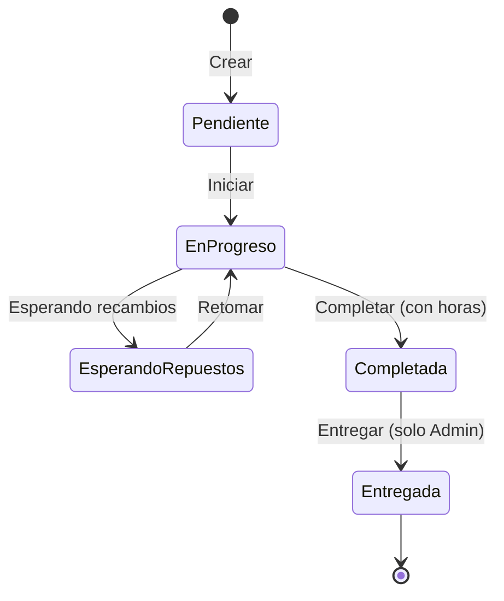

# Guía funcional

Describe qué resuelve TALLER .NET, qué puede hacer cada perfil y qué reglas aplica la aplicación. Todo lo indicado se ha contrastado con el código del repositorio.

Documentos relacionados: [README](../README.md) · [Modelo de datos](diagrama-er.md) · [Autenticación y roles](autenticacion-y-roles.md) · [Cuentas y guion de demostración](demo.md).

## Qué resuelve la aplicación

TALLER .NET centraliza la gestión de un taller mecánico:

- Alta de clientes y de sus vehículos.
- Seguimiento de cada reparación, desde que se abre hasta que se entrega.
- Control del almacén de recambios y de las piezas usadas en cada reparación.
- Área privada en la que el cliente consulta sus vehículos y sus reparaciones.

## Perfiles

La aplicación define cuatro roles: `Admin`, `Mechanic`, `Customer` y `User`. Sin iniciar sesión solo se accede a la portada, el login y el registro.

### Admin

- Gestiona las cuentas desde **Administración de usuarios**: buscar, crear, editar, asignar rol, activar/desactivar, restablecer la contraseña y eliminar.
- No puede quitarse a sí mismo el rol `Admin`, desactivar su cuenta ni eliminarla.
- Siempre debe quedar al menos un administrador activo.
- Gestiona vehículos, recambios y todas las reparaciones.
- Es el único que asigna mecánico y tarifa, entrega vehículos, elimina reparaciones, cambia el precio de una pieza usada y modifica reparaciones cerradas.

### Mechanic

- Consulta todos los vehículos del taller y puede crearlos, editarlos y eliminarlos.
- Gestiona el catálogo de recambios.
- Ve solo las reparaciones que tiene asignadas.
- Abre reparaciones, que quedan asignadas a su cuenta con una tarifa de 45 €/h.
- Edita, cambia de estado y añade o quita piezas en sus reparaciones mientras no estén cerradas.

### Customer

- Consulta solo sus propios vehículos y las reparaciones de esos vehículos.
- Ve en cada reparación el mecánico, el estado, el kilometraje de entrada, las piezas usadas y el coste total.
- Cuando la reparación está completada, ve un aviso para recoger el vehículo.
- Consulta el catálogo de recambios.
- No modifica nada del taller.

### User

- Es el rol que recibe cualquier persona que se registra desde **Crear cuenta**.
- Un administrador puede cambiarle el rol desde **Administración de usuarios**.
- Gestiona su perfil y consulta el catálogo de recambios. No tiene vehículos hasta que pasa a `Customer`.

### Todos los perfiles

- Cambio de tema claro u oscuro, con la preferencia guardada en el navegador.
- Edición de perfil (nombre visible, email y avatar) y cambio de contraseña.
- Verificación en dos pasos (2FA TOTP).
- Contraseña de al menos 8 caracteres, con un dígito y un carácter no alfanumérico.
- Bloqueo de la cuenta durante 15 minutos tras 5 intentos de acceso fallidos.

## Permisos por perfil

La tabla refleja lo que el código aplica hoy.

| Funcionalidad | Admin | Mechanic | Customer | User |
|---|:---:|:---:|:---:|:---:|
| Administración de usuarios | Sí | No | No | No |
| Gestionar el perfil propio y 2FA | Sí | Sí | Sí | Sí |
| Consultar vehículos | Todos | Todos | Solo propios | Solo propios (1) |
| Crear, editar y eliminar vehículos | Sí | Sí | No | No |
| Consultar reparaciones y piezas usadas | Todas | Solo asignadas | De sus vehículos | De sus vehículos (1) |
| Crear reparaciones | Sí | Sí, asignadas a sí mismo | No | No |
| Editar reparaciones, cambiar estado y gestionar piezas | Todas (2) | Asignadas y abiertas | No | No |
| Cambiar mecánico, tarifa o precio de una pieza | Sí | No | No | No |
| Entregar y eliminar reparaciones | Sí (2) | No | No | No |
| Consultar recambios | Sí | Sí | Sí | Sí |
| Crear, editar y eliminar recambios | Sí | Sí | No | No |

Notas:

1. Un `User` normalmente no tiene vehículos, porque solo un `Customer` puede asignarse como propietario.
2. Si la reparación está cerrada hay que confirmar la acción.

El detalle de un recambio muestra solo las reparaciones que la cuenta puede ver.

## Ciclo de vida de una reparación



- Toda reparación nueva empieza como **Pendiente**.
- El estado solo cambia con los botones del detalle. El formulario no permite editarlo.
- Para completar hay que haber apuntado horas de mano de obra. Se registra la fecha de cierre.
- **Completada** y **Entregada** son estados cerrados. No hay forma de reabrir una reparación.

## Reglas de negocio

### Stock automático

- Al añadir una pieza a una reparación, el stock del recambio baja en la cantidad indicada.
- Si no hay stock suficiente, la aplicación muestra un aviso y no guarda la pieza.
- Al editar la cantidad o cambiar el recambio de una línea, el stock se recalcula.
- Al eliminar una línea o una reparación, las unidades vuelven al almacén, también si la reparación estaba cerrada.
- La cantidad por línea debe estar entre 1 y 1000.
- El listado de recambios resalta con **Stock bajo** los que tienen un stock igual o inferior al mínimo.

### Reparaciones cerradas

- Un mecánico no puede modificar una reparación completada o entregada, ni sus piezas.
- Un administrador puede editarla, eliminarla o cambiar sus piezas marcando una casilla de confirmación. El servidor también la comprueba.

### Precio histórico

- Cada línea de reparación guarda el precio unitario del momento en que se añade la pieza.
- Un cambio posterior del precio en el catálogo no modifica las reparaciones ya registradas.
- Solo un administrador puede cambiar a mano el precio de una línea.

### Coste de la reparación

La aplicación no guarda un total. Lo calcula al consultar la reparación:

```text
Coste = (LaborHours × HourlyRate) + Σ(Quantity × UnitPrice)
```

### Validaciones del vehículo

- El VIN tiene exactamente 17 letras o números, sin I, O ni Q.
- El propietario debe ser una cuenta con rol `Customer`.

### Factura

- Una reparación completada o entregada ofrece **Descargar factura** (PDF) a quien puede verla: el `Admin`, el mecánico asignado y el cliente propietario.
- Los conceptos son la mano de obra y las piezas, con su precio histórico. A esa base se le suma el IVA configurado (21 % por defecto): el **coste total** que muestra la aplicación no lo incluye.
- El número es `F-<año>-<número de reparación>` y la fecha, la de cierre.
- **No es un documento fiscal válido:** la numeración no es correlativa, la factura no se registra y no se guardan el NIF ni el domicilio del cliente.

### Protección del historial

- No se puede eliminar un vehículo que tenga reparaciones.
- No se puede eliminar un recambio que se haya usado en alguna reparación.
- La base de datos impide borrar una cuenta que tenga vehículos o reparaciones asignadas.
- Eliminar una reparación elimina también sus líneas de piezas.

### Datos únicos

- La matrícula del vehículo no se puede repetir.
- La referencia del recambio no se puede repetir.

## Estados y tipos de reparación

Los valores están en [Modelo de datos](diagrama-er.md#valores-de-los-enums).

## Limitaciones conocidas

- Eliminar desde la administración una cuenta con vehículos o reparaciones produce un error 500 en vez de un aviso. Como alternativa, desactívala.
- El estado **Entregada** no guarda la fecha de entrega.
- Abrir una reparación no comprueba ni actualiza el kilometraje del vehículo.
- El filtro `/SpareParts?lowStock=true` funciona, pero ninguna pantalla enlaza a él.
- La portada menciona presupuesto y registro de reparaciones con prioridad por parte del cliente; la aplicación no ofrece ninguna de las dos cosas.

La lista completa de errores abiertos está en el [planning](planning.md).
