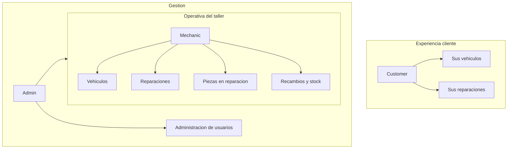

# Presentación del proyecto (Fundación Adecco y empresas)

Material orientado a sesiones con **consultores de empleabilidad**, **empresas colaboradoras** y **público no técnico**. El detalle técnico y de producto sigue en la [guía funcional](guia-funcional.md), el [README](../README.md) y la [demostración](demo.md).

Documentos del paquete:

| Documento | Uso |
|---|---|
| Este dossier | Lectura previa y referencia durante la reunión |
| [Guion 45 minutos](guion-presentacion-adecco.md) | Cronometraje y plan B |
| [Outline de diapositivas](diapositivas-presentacion-adecco.md) | Títulos, bullets y notas del orador |
| [Diapositivas (Marp)](diapositivas-presentacion-adecco.marp.md) | Exportar a PDF o PPTX |

## Resumen ejecutivo

**TALLER .NET** es una aplicación web que centraliza la operativa de un **taller mecánico**: clientes y vehículos, reparaciones con seguimiento de estado, almacén de recambios y un **área privada** para que cada cliente consulte sus vehículos y reparaciones.

Es un **proyecto académico del Grupo 3** (formación .NET), con alcance de **prototipo funcional avanzado**: reglas de negocio reales (stock, costes, historial) y stack actual de mercado laboral (.NET 10, ASP.NET Core MVC, Entity Framework Core, Identity).

**Beneficiarios del producto (visión negocio):**

- El **taller**: menos fricción entre recepción, mecánico y almacén; trazabilidad de piezas y costes.
- El **cliente**: transparencia sobre el estado de la reparación, piezas y coste total calculado.
- El **administrador**: gestión de cuentas y roles en un único sistema.

Repositorio público: [certidevs/g3_aspnet](https://github.com/certidevs/g3_aspnet).

## Contexto sectorial

Las pymes del automoción suelen combinar agenda, partes en papel o herramientas dispersas y poca visibilidad para el cliente final. La digitalización aporta:

- **Trazabilidad**: qué se hizo en cada vehículo, quién lo atendió y con qué piezas.
- **Stock fiable**: salidas automáticas al consumir recambios en una reparación.
- **Experiencia del cliente**: acceso autenticado a *sus* vehículos y reparaciones, sin ver datos de otros clientes.
- **Base para empleabilidad**: el proyecto demuestra construcción end-to-end de un producto web con roles, persistencia y pruebas.

TALLER .NET no sustituye un ERP completo; **demuestra un núcleo digital** que un taller podría ampliar en un piloto.

## Propuesta de valor (cuatro pilares)

| Pilar | Qué ofrece la aplicación |
|---|---|
| **Gestión integral del taller** | Vehículos, reparaciones, mecánico asignado, estados y tipos de intervención |
| **Almacén conectado al trabajo** | Catálogo de recambios; las piezas usadas en reparación ajustan el stock |
| **Cliente informado** | Perfil `Customer`: solo sus vehículos y reparaciones; ve coste total y piezas |
| **Seguridad y cuentas** | Registro, roles (`Admin`, `Mechanic`, `Customer`, `User`), perfil, bloqueo tras intentos fallidos |

Detalle de permisos y reglas: [guía funcional](guia-funcional.md).

## Usuarios y recorridos

| Perfil | En la práctica |
|---|---|
| `Admin` | Usuarios del sistema y operación completa del taller |
| `Mechanic` | Vehículos, reparaciones, piezas y recambios |
| `Customer` | Consulta de sus vehículos y reparaciones; catálogo de recambios |
| `User` | Cuenta recién registrada hasta que un administrador asigne otro rol |

## Demostración recomendada en reunión

Guion completo y credenciales: [demostración](demo.md) (solo entorno de desarrollo).

**Cinco escenarios que mejor transmiten valor:**

1. **Vista cliente** — `customer` ve solo sus matrículas; detalle de reparación con coste y piezas.
2. **Flujo mecánico** — alta de reparación, consumo de recambio y bajada de stock.
3. **Stock insuficiente** — la aplicación avisa y no guarda la línea.
4. **Precio histórico** — el precio de la línea en una reparación antigua no cambia si se actualiza el catálogo.
5. **Administración** — búsqueda de usuarios y cambio de rol de `User` a `Customer`.

Duración sugerida en vivo: unos **20 minutos**, dentro de una sesión de **45 minutos** ([guion](guion-presentacion-adecco.md)).

## Competencias y empleabilidad

El proyecto consolida habilidades demandadas en desarrollo web y en equipos ágiles:

| Competencia | Evidencia en el proyecto |
|---|---|
| Desarrollo back-end .NET | ASP.NET Core MVC, .NET 10 |
| Modelo de datos y ORM | Entity Framework Core, SQLite |
| Autenticación y autorización | ASP.NET Core Identity, roles, políticas de contraseña |
| Front-end web | Razor, Bootstrap 5, accesibilidad básica, tema claro/oscuro |
| Calidad | Pruebas unitarias (xUnit) en `tests/G3AspNet.Tests/` |
| Entrega e ingeniería | Docker, GitHub Actions (CI), flujo de ramas y pull requests |
| Trabajo en equipo | Repositorio compartido, documentación y wiki sincronizado |

Formación contextualizada en un **dominio de negocio** (taller) facilita explicar el valor en entrevistas y en empresas del sector servicios y automoción.

## Evidencias de calidad

- Integración continua en cada cambio a `main` (badge CI en [README](../README.md)).
- Suite de pruebas automatizadas (modelos de dominio, relaciones, validaciones).
- Documentación estructurada: funcional, modelo de datos, demo y guías de contribución.
- Contenedor Docker para ejecutar la aplicación sin instalar el SDK en el auditorio.

## Madurez actual

| Aspecto | Estado |
|---|---|
| Funcionalidad de taller | Implementada: vehículos, reparaciones, stock, costes, área cliente |
| Entorno | Prototipo **en desarrollo**; adecuado para demo y evaluación formativa |
| Base de datos | En cada arranque se recrea el esquema y los datos de ejemplo; **no es persistencia de producción** |
| Despliegue | Perfil local y Docker; sin piloto productivo declarado aún |

Mensaje para consultores: el equipo demuestra **capacidad de llevar un producto de cero a demo estable**; el paso a piloto con un taller implica persistencia, endurecimiento de seguridad por rol y acuerdos de datos (véase roadmap).

## Roadmap hacia un piloto

Hitos realistas alineados con el estado del código y la documentación técnica:

1. **Persistencia** — migraciones EF Core y datos que no se borren en cada arranque.
2. **Datos de ejemplo** — seed solo en desarrollo; credenciales fuertes o sin cuentas fijas en otros entornos.
3. **Autorización en módulos de taller** — reforzar qué rol puede crear, editar o borrar reparaciones y recambios.
4. **Alertas de stock** — avisar cuando el stock llega al mínimo (`MinStock` ya existe en el modelo).
5. **Licencia y gobernanza** — declarar licencia en el repositorio y criterios de uso con empresa colaboradora.
6. **Piloto controlado** — despliegue en entorno de prueba con un taller y feedback de usuarios reales.

## Preguntas frecuentes (consultores y empresas)

### ¿Se puede usar en producción hoy?

No como producto terminado. Es un **prototipo formativo** con base de datos efímera en el arranque actual. El roadmap describe el camino a piloto.

### ¿Qué datos personales maneja?

Cuentas de usuario (correo, nombre visible, avatar opcional), vehículos asociados al propietario y reparaciones. Usa el modelo estándar de Identity. En un piloto habría que aplicar política de privacidad, retención y hosting conforme a RGPD.

### ¿Cuánto cuesta desplegarlo?

Stack abierto: puede ejecutarse en un servidor modesto o contenedor; SQLite es suficiente para demo; un piloto podría valorar SQL Server o PostgreSQL. Sin licencias de producto propietario obligatorias para la demo actual.

### ¿Qué necesitaríamos de una empresa colaboradora?

Acceso a 2–3 usuarios de prueba (recepción, mecánico, cliente), validación de flujos reales y feedback en 4–6 semanas; no requiere integración con su ERP en una primera fase.

### ¿Cómo se evalúa al equipo en una sesión?

Demo en vivo, explicación de roles y reglas de negocio, y conversación sobre stack + trabajo en Git. Material de apoyo: [outline de diapositivas](diapositivas-presentacion-adecco.md).

## Anexos

| Recurso | Enlace |
|---|---|
| Guía funcional | [guia-funcional.md](guia-funcional.md) |
| Modelo de datos (Mermaid) | [diagrama-er.md](diagrama-er.md) |
| Diagrama ER (imagen) | [img/modelo_entidad_relacion.png](img/modelo_entidad_relacion.png) |
| Instalación y ejecución | [README](../README.md#instalación-y-ejecución) |
| Equipo Grupo 3 | [README](../README.md#equipo) |
